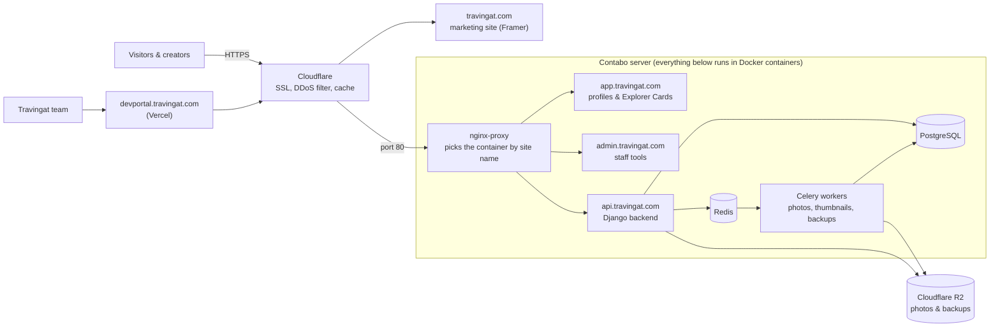

# Tech Stack at a Glance

Every tool we use, in one table: what it is, what it does for Travingat, and why we picked it. For the deep detail, see [Architecture](/tech-docs/Techstack), [Data Model](/tech-docs/Data-Model), [Media Engine](/tech-docs/Media-Engine), [Get Featured](/tech-docs/Get-Featured), [Explorer Cards](/tech-docs/Explorer-Cards), [Waitlist](/tech-docs/Waitlist), [Admin Platform](/tech-docs/Admin-Platform) and the [Runbook](/tech-docs/Runbook).

| Part | Technology | What it does for Travingat | Why we chose it |
| :--- | :--- | :--- | :--- |
| **Marketing website** | Framer | The public site at `travingat.com`: landing page, pricing, blog and waitlist. | The team can edit and publish marketing pages without an engineer. |
| **Product web app** | Next.js 16 + React 19 (`travingat-landing`) | Creator profiles, Explorer Cards and the Get Featured flow at `app.travingat.com`. | Public profiles load fast and show up well in search, and the same framework handles the interactive editors. |
| **Admin dashboard** | Next.js 16 (`travingat-admin`) | Where staff review profiles, approve Get Featured requests and manage the waitlist and users at `admin.travingat.com`. | Same stack as the product, so one developer can work on both. |
| **Developer portal** | Next.js 16 (`devportal`) on Vercel | Media Engine monitoring, service-cost tracking and these docs. | Hosted on Vercel, away from the production server, so internal tooling never slows down the product. |
| **Backend API** | Python, Django 4.2 + Django REST Framework, served by Daphne | The brain. Holds every business rule (sign-in, profiles, cards, waitlist, uploads) and answers every app at `api.travingat.com`. | Mature and secure, with built-in tools for safe database changes. |
| **Database** | PostgreSQL 18 | Stores every user, profile, card and media record. The single source of truth. | Reliable and relational, and it runs next to the API, so it is fast. |
| **Live updates** | Django Channels (WebSockets) | Pushes Media Engine job progress to the dashboard the moment it changes. | No refreshing or polling needed. |
| **Email** | Django email (SMTP) | Sends one-time login codes, waitlist confirmations and approval emails. | Built into Django, and the templates live next to the code. |
| **Background jobs** | Celery | The worker. Does slow work (optimising photos, making thumbnails, backups, cleanups) in the background, so a creator never waits on it. Separate workers handle photos, thumbnails and maintenance, so a pile of uploads can't block a backup. "Celery beat" starts the scheduled jobs. | The standard Python tool for background work. |
| **Job queue and cache** | Redis 7 | The notice board Celery picks jobs from. It also carries live updates to the dashboard and keeps frequently used answers handy. | Extremely fast, and one tool covers all three jobs. |
| **Photo processing** | libvips | Does the actual image work: shrinks each upload and converts it to AVIF. Think "Save for web", but automatic. | Much faster and lighter on memory than older image tools. |
| **Photo format** | AVIF | The format every photo is stored in. A 4 MB JPEG often becomes a few hundred KB. | Smaller files mean faster pages on mobile data and lower storage cost. |
| **Photo placeholder** | Blurhash | A short piece of text, saved in the database, that the browser turns into a soft blurred preview while the real photo loads. | The page never looks empty or jumps around. |
| **Photo storage and CDN** | Cloudflare R2 + `cdn.travingat.com` | Stores every photo and the hourly database backups, and serves photos worldwide. | Works like Amazon S3, but with no bandwidth fees. |
| **Server** | Contabo VPS | The rented computer in a data centre where Travingat actually runs: the backend, database, Redis, Celery workers and both customer-facing Next.js apps. Think of it as the building. | Predictable monthly cost and full control. |
| **Containers** | Docker (Docker Compose) | Runs each part (backend, database, Redis, every worker, each Next.js app) in its own sealed container on the Contabo server. Think of it as the shops inside the building. A crash in one doesn't touch the others, the database and workers have memory limits, and containers restart themselves after a reboot. | The same setup runs everywhere, so moving to a new server is a short, written procedure. See the [Runbook](/tech-docs/Runbook). |
| **Traffic routing** | nginx-proxy | Looks at the site name in each request (`app`, `admin` or `api`) and sends it to the right container. It is the only public door on the server. | One entry point, with routing set up automatically. |
| **Front door** | Cloudflare | Sits in front of the whole platform: DNS, free SSL, DDoS and bot protection, caching, and a small Worker that sends `travingat.com/<username>` to that creator's profile. Traffic goes browser → Cloudflare → Contabo, so the server's database, Redis and API are never exposed directly. | Protects the server and speeds up every site. |
| **Deploys** | GitHub Actions | Checks the code, then updates the server when we push to `main`. | Releases are automatic and repeatable. |
| **Error tracking** | Sentry | Catches every error from the backend and the background workers and shows exactly where it happened, so developers can fix problems without waiting for a user report. | Problems get fixed faster, often before anyone notices. |
| **Metrics** | Prometheus | Collects running numbers from the backend (requests, response times, database speed) from a private, token-protected address. | Shows slowdowns building up before they turn into outages. |
| **Logs** | JSON logs | Every line the backend writes is structured and carries a request ID. | One request can be followed from the browser all the way to an error. |
| **Uptime** | Uptime Kuma (`status.travingat.com`) + health check | Uptime Kuma keeps checking that our sites and API are reachable, and powers the status page with uptime and incidents. The backend also has a simple `/api/health` address that answers "I'm alive". | Free, open-source and self-hosted, and one place for the team and clients to see whether everything is online. |
| **Dashboards** | Grafana (`grafana.travingat.com`) | Charts of the platform's health numbers. | Easier to read than raw numbers. |

### How to read this

- **One person, one record.** Everyone is a single user row in PostgreSQL. Their profile and Explorer Card both read name, country and flags from it. See [Data Model](/tech-docs/Data-Model).
- **Photos never pass through the web server.** Browsers upload straight to R2, then Celery and libvips optimise them in the background.
- **Backups leave the server every hour.** A compressed database snapshot goes to R2 each hour. Hourly copies are kept for 24 hours, and one per day is kept for 30 days.
