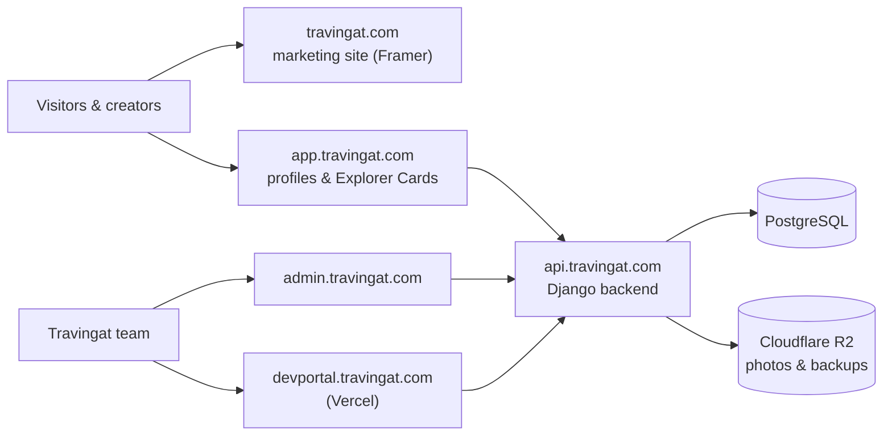

# Tech Stack at a Glance

This page answers "what does Travingat run on, and why?" in one place. For the detail behind each row, see [Architecture](/tech-docs/Techstack), [Data Model](/tech-docs/Data-Model), [Media Engine](/tech-docs/Media-Engine), [Get Featured](/tech-docs/Get-Featured), [Explorer Cards](/tech-docs/Explorer-Cards), [Waitlist](/tech-docs/Waitlist), [Admin Platform](/tech-docs/Admin-Platform), and the [Runbook](/tech-docs/Runbook) for when something goes wrong.

| Part | Technology | What it does | Why we chose it |
| :--- | :--- | :--- | :--- |
| **Marketing website** | Framer | The public landing page, pricing, blog and waitlist pages on `travingat.com` | The team can publish marketing changes without an engineer |
| **Product web app** | Next.js 16 + React 19 (`travingat-landing`) | Creator profiles, Explorer Cards and the Get Featured flow on `app.travingat.com` | One framework for fast server-rendered public pages and interactive editors |
| **Admin dashboard** | Next.js 16 (`travingat-admin`) | Profile review, Get Featured approvals, waitlist, users and recycle bin on `admin.travingat.com` | Same stack as the product, so staff tools stay in step with it |
| **Developer portal** | Next.js 16 (`devportal`), hosted on Vercel | Media Engine monitoring, service-cost tracking and these docs | Kept off the production server so ops tooling never competes with the product |
| **Backend API** | Django 4.2 + Django REST Framework, served by Daphne | Accounts, profiles, cards, waitlist, media processing and all business rules on `api.travingat.com` | Mature, secure, and quick to build on, with migrations for safe schema changes |
| **Database** | PostgreSQL 18 | The single source of truth for every person, profile, card and media record | Reliable, relational, and runs right next to the API for low latency |
| **Background jobs** | Celery + Redis | Image optimisation, thumbnails, scans, hourly backups | Heavy work runs outside the web request, so pages stay fast |
| **Live updates** | Django Channels over WebSockets | Pushes Media Engine job progress to dashboards as it happens | No polling; the dashboard updates the moment a job finishes |
| **File storage & CDN** | Cloudflare R2 + `cdn.travingat.com` | Stores every photo and the database backups; serves photos worldwide | S3-compatible with no bandwidth fees |
| **Image processing** | libvips (AVIF) and Blurhash | Converts uploads to small AVIF files and makes blurred placeholders | Very fast and memory-efficient; AVIF is far smaller than JPEG |
| **Hosting** | One Contabo VPS running Docker, behind Cloudflare | Runs the backend, database, Redis, workers and both Next.js apps | Predictable cost and full control; Cloudflare adds SSL and DDoS protection |
| **Monitoring** | Sentry, Prometheus metrics, JSON logs | Error alerts, request metrics and traceable logs | Problems show up quickly, with the request that caused them |
| **Email** | Django email (SMTP) | One-time login codes, waitlist confirmation, approval and feedback emails | Built into the backend; templates live next to the code |

### How to read this

- **One person, one record.** Everyone is a single user row in PostgreSQL. Their profile and Explorer Card both read name, country, countries and flags from it. See [Data Model](/tech-docs/Data-Model).
- **Photos never pass through the web server.** Browsers upload straight to R2, then the Media Engine optimises them in the background.
- **Backups leave the server every hour.** A compressed database snapshot is written to R2 hourly, with one daily snapshot kept for 30 days.
