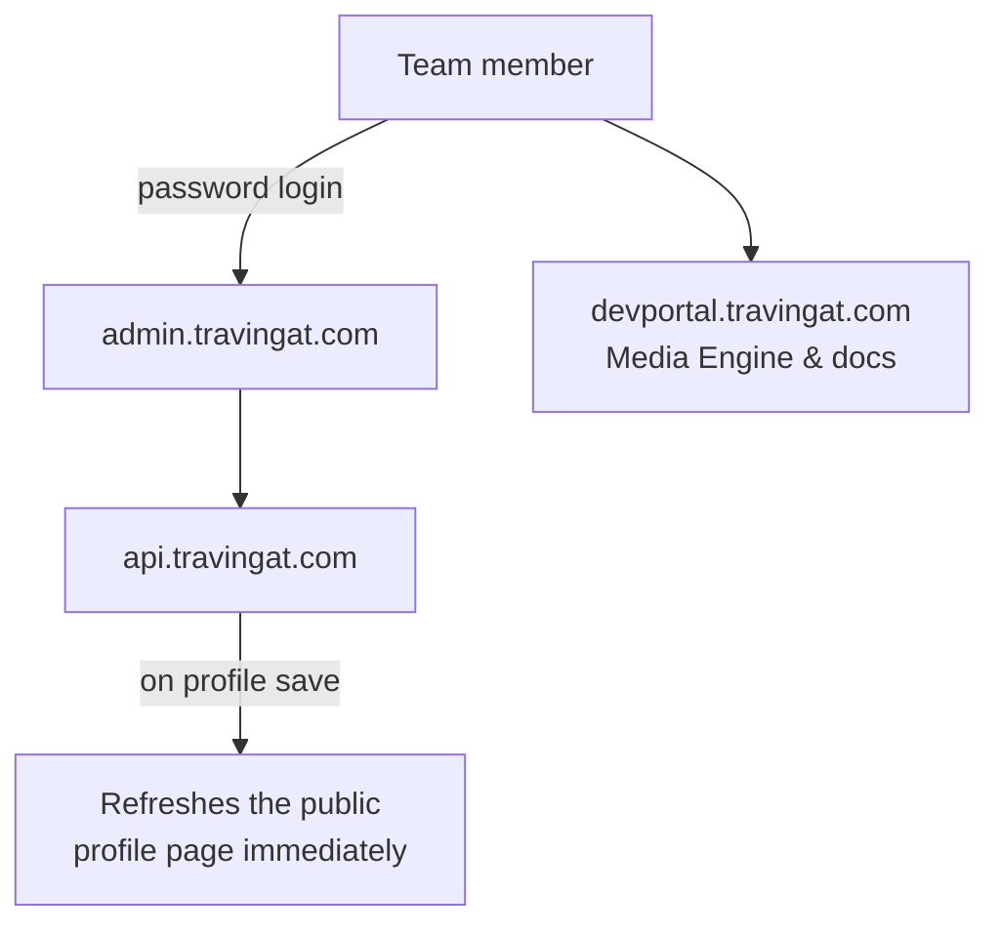
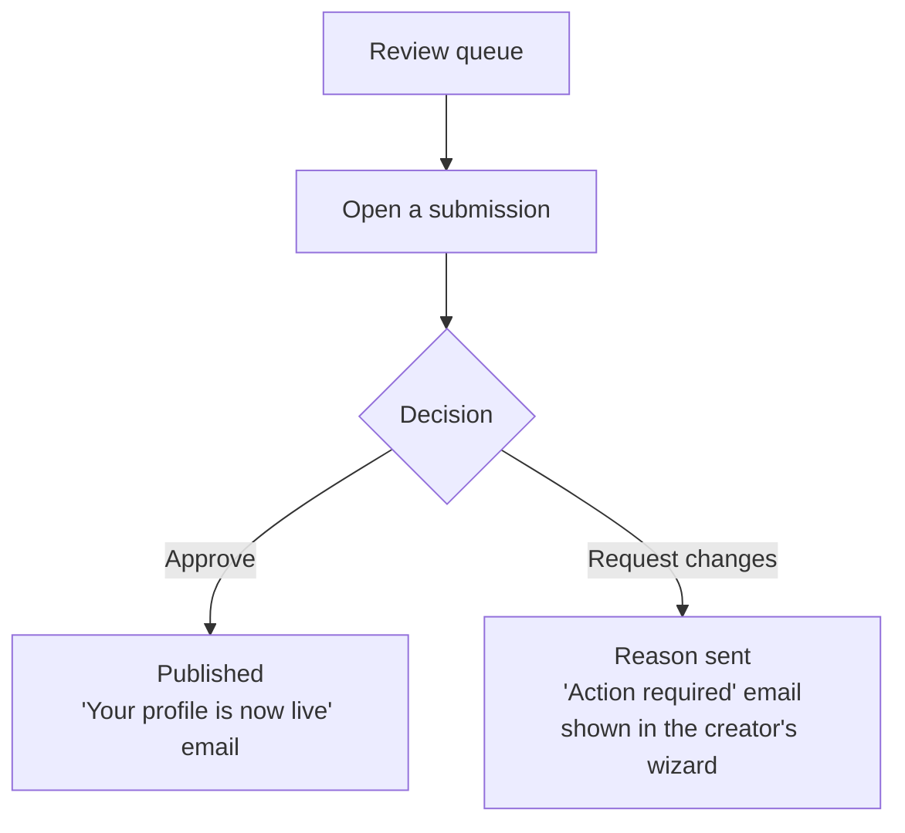
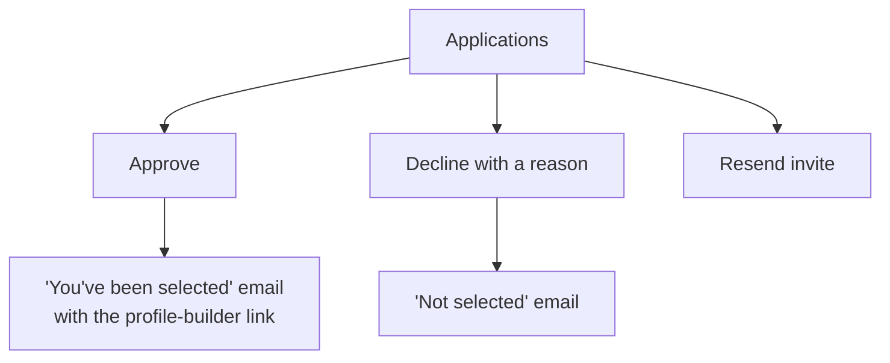

# Admin Platform — Operations Dashboard

`travingat-admin` (`admin.travingat.com`) is where the team runs the platform day to day: approving applications, reviewing profiles, building sample profiles, managing the waitlist and users, and recovering deleted records. Every action goes straight to the backend API and takes effect on the live site immediately.

---

## 1. Sections

| Section | What it's for |
| :--- | :--- |
| **Dashboard** | Counts: Explorer Cards, pending Get Featured requests, published profiles |
| **Featured Requests** | Approve or decline [Get Featured](/tech-docs/Get-Featured) applications; resend invites |
| **Profiles → Review** | The review queue, filtered by status: ready for review, changes requested, published, draft, all |
| **Profiles → Editor** | Build or edit any profile, including sample profiles |
| **Profiles → Orphans** | R2 files no profile, card or user references |
| **Users** | Registered accounts with their card and profile; sample accounts are not listed |
| **Waitlist** | Every signup with its context and funnel status |
| **Recycle Bin** | Restore or permanently delete removed users, profiles and waitlist entries |

Login is a shared password that sets a signed `admin_session` cookie (24 hours). The same session works in devportal.

---

## 2. Profile review

Sample profiles never appear in the review queue.

---

## 3. Featured Requests

---

## 4. Profile editor and sample profiles

The editor is the same multi-step builder creators use, with extra controls for the team: featured on/off, review status, sample badge, Explorer Card style and badge.

- **Sample profiles:**
  - Profiles created without an email (the sample creators on the site) get a placeholder account, `sample+<handle>@travingat.internal`. Nobody can log in to it.
  - The editor's **Sample** toggle only controls the sample badge on the profile.
  - Placeholder accounts are hidden from **Users** and can't be deleted from admin. Each one owns a sample profile and its photos, which hold most of the platform's images.
- **Editing:**
  - Saving re-saves only the sections you changed, and photos already on a profile are never dropped.
  - The public profile page is refreshed straight away.
- **Email field:** it shows the owner's email, and is blank for sample profiles. Changing it does **not** move a profile to another account or change anyone's login email.
- **Explorer Card badge:** profile and card share one badge flag. Toggling it in either place updates both.

---

## 5. Users and waitlist

- **Users:** every registered account, with its Explorer Card and Featured Profile. Deleting a user here is a soft delete; it hides the user, their profile and their waitlist entry, and all can be restored.
- **Waitlist:** see [Waitlist](/tech-docs/Waitlist). You can resend the confirmation email or remove an entry.

---

## 6. Recycle bin

Users, profiles and waitlist entries removed in admin go to the recycle bin. Each can be **restored** in full or **permanently deleted**.

> **Note:** the recycle bin says deleted items are "automatically purged" after 30 days and shows a countdown, but **no automatic purge runs**. Items stay until someone permanently deletes them. Either add a scheduled purge, or change that wording in `RecycleBinClient.tsx`.

**Permanent delete:**
- **User:** deletes their waitlist entry, their Featured Profile with all its photo rows, their Explorer Card, then the user.
- **Profile:** deletes it with its photo folders, collections and image rows.
- **Placeholder (sample) accounts:** refused.
- **Files:** the photos in R2 are not deleted. They show up later in **Orphans**.

---

## 7. Orphan files

**Profiles → Orphans** lists R2 objects under the upload prefixes that nothing references:
- profile and country photos, collection covers and header images;
- user avatars and covers, and Explorer Card photos;
- photos of soft-deleted profiles and users, which count as in use because they can be restored.

Its delete action **permanently removes files from R2**, so review the list first.

---

## 8. Platform

| | |
| :--- | :--- |
| Framework | Next.js 16, React 19, TypeScript, Tailwind CSS 4 |
| Data | TanStack Query over the backend API |
| Auth | Shared password → `admin_session` cookie issued by the backend |
| Hosting | Container on the Contabo VPS; see [Architecture](/tech-docs/Techstack) |
