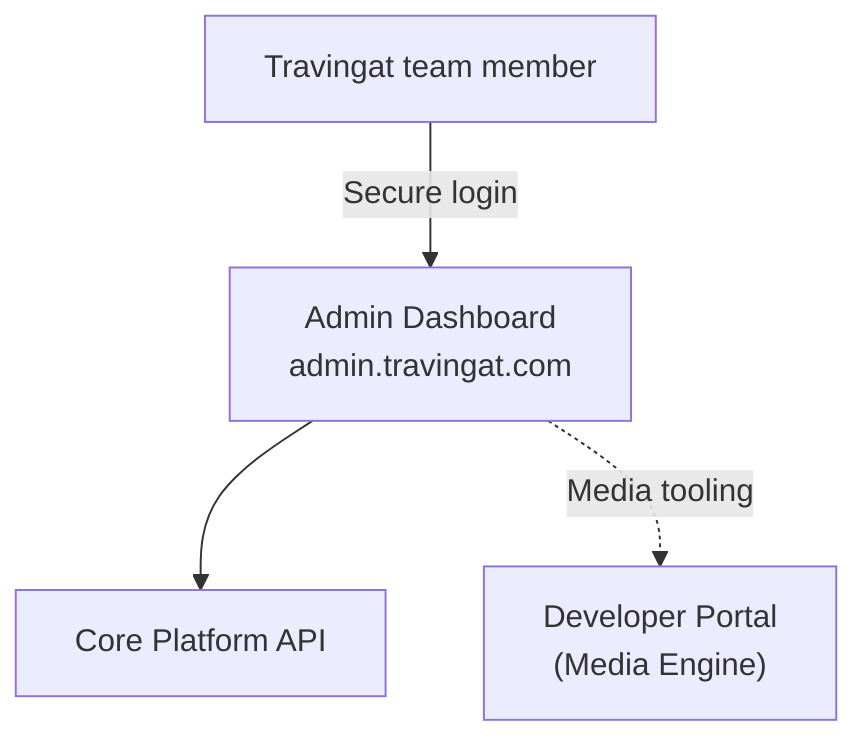
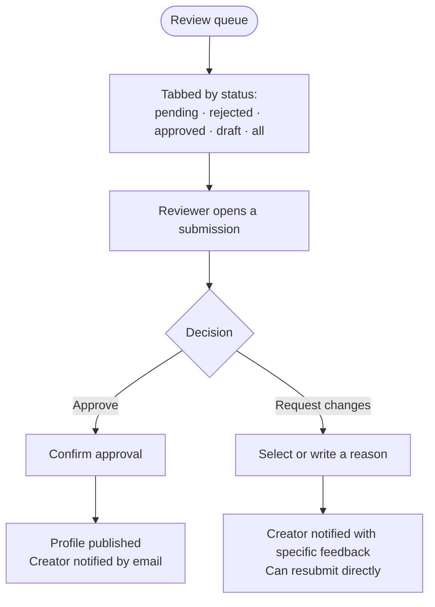
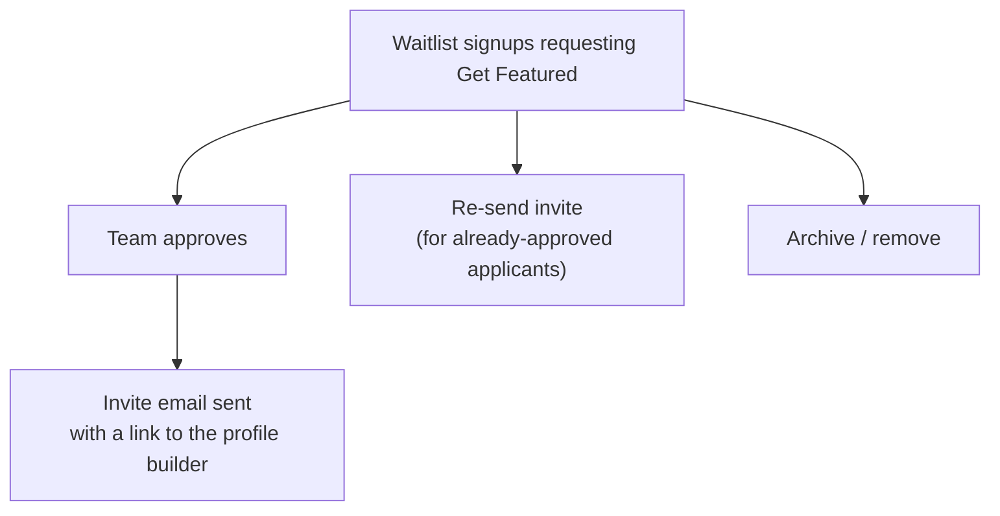

# Admin Platform — Operations Dashboard

`travingat-admin` (`admin.travingat.com`) is the backoffice dashboard the Travingat team uses to run the platform day to day: reviewing and approving creator profiles, managing the waitlist, approving Get Featured applications, moderating blog and testimonial content, and recovering accidentally deleted records.

---

## 1. What the Team Can Do

| Area | Purpose |
| :--- | :--- |
| **Dashboard** | At-a-glance stats — explorer cards created, pending Get Featured requests, published profiles |
| **Profile Review** | A tabbed queue (pending / rejected / approved / draft / all) for approving or requesting changes on submitted Featured Profiles |
| **Featured Requests** | Approving or re-inviting creators who applied for Get Featured, triggering the email that unlocks their profile builder |
| **Profile Editor** | A full step-by-step profile builder the team can use directly, for creating or editing any creator's profile on their behalf |
| **Waitlist & Users** | Full visibility into early-access signups and registered users, with signup context (device, browser, region) |
| **Blog & Testimonials** | Content moderation and publishing for marketing-facing content |
| **Recycle Bin** | Recovery of soft-deleted records within a 30-day retention window, with full restore or permanent purge |

---

## 2. Profile Review Workflow

Each decision triggers an automatic email to the creator — an approval notification, or specific, actionable feedback when changes are requested — so the team never has to follow up manually.

---

## 3. Featured Request Approval

---

## 4. Recycle Bin

Soft-deleted records — profiles, users, and featured requests — are retained for 30 days before permanent removal, giving the team a safety net against accidental deletion. Any record in this window can be fully restored or permanently purged on demand.

---

## 5. Platform Summary

| Category | Detail |
| :--- | :--- |
| Framework | Next.js 16, React 19, TypeScript, Tailwind CSS v4 |
| Data & caching | TanStack React Query for live cache synchronization |
| Authentication | Secure, cookie-based session for the shared team login |
| Hosting | Dedicated container alongside the rest of the Travingat platform — see the [Tech Stack](/tech-docs/Techstack) overview |

The admin platform is a focused operations layer on top of the same core platform API that powers the consumer-facing product — every review decision, approval, and edit made here takes effect immediately across the live product.
