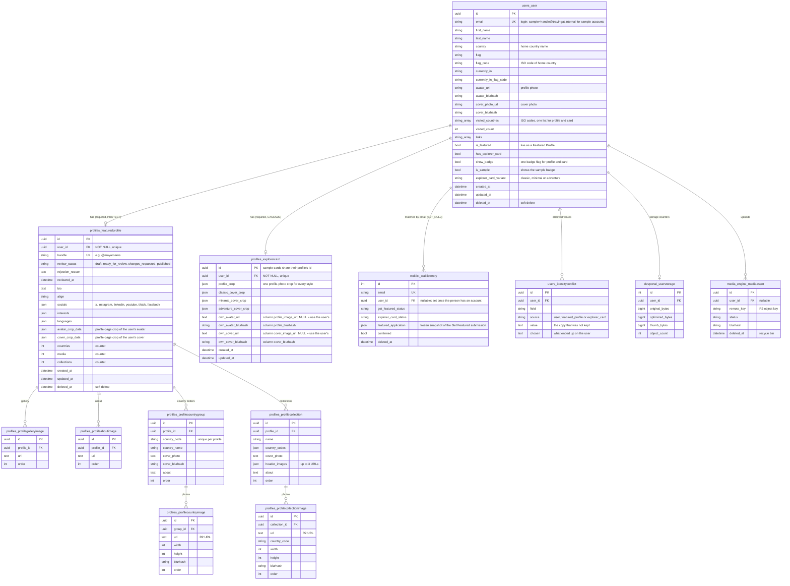
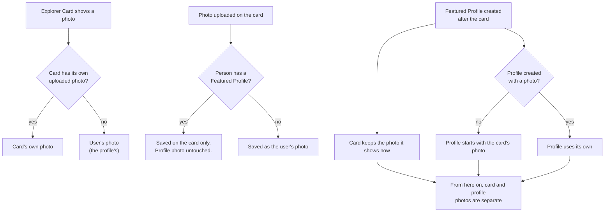

# Data Model — Users, Profiles & Explorer Cards

Every person on Travingat is **one row in `users_user`**. That row holds who they are: name, home country, avatar and cover photo, visited countries, and their status flags. The two things a person can make sit on top of it:

- a **Featured Profile** (`profiles_featuredprofile`) holds only the profile's *content*: handle, bio, socials, photo folders and collections;
- an **Explorer Card** (`profiles_explorercard`) holds only what is specific to the card: its crops and any photos uploaded on the card itself.

Nothing about a person is stored twice. A profile and a card read the person's name, country, countries and flags from the same `users_user` row, so editing them in one place updates both.

> This layout has been in place since 9 Nov 2026. Before that, name, country, photos, visited countries and flags were copied separately onto the user, the profile and the card. See [Migration history](#migration-history).

---

## 1. Entity relationship diagram

Media processing (`MediaVariant`, `MediaJob`, `JobLog`) and the devportal tables are covered in [Media Engine](/tech-docs/Media-Engine) and [Tech Stack & Architecture](/tech-docs/Techstack).

---

## 2. Where each piece of data lives

| Data | Stored on | Read by |
| :--- | :--- | :--- |
| Name, home country, flag, "currently in" | `users_user` | profile page, Explorer Card, admin, waitlist list |
| Visited countries | `users_user.visited_countries` (ISO codes) | profile (as codes), Explorer Card (as display names) |
| Profile photo & cover (the profile's) | `users_user.avatar_url` / `cover_photo_url` | profile page; the card when it has no photo of its own |
| Card's own photo & cover | `profiles_explorercard.own_avatar_url` / `own_cover_url` | Explorer Card only |
| Featured / badge / sample / card style | `users_user` flags | profile page, card, admin review queue |
| Handle, bio, socials, interests, languages | `profiles_featuredprofile` | profile page |
| Review workflow | `profiles_featuredprofile.review_status` | admin review, Get Featured status |
| Country folders, collections, photos | `profiles_profile*` image tables | profile page |
| Profile-page crops | `profiles_featuredprofile.avatar_crop_data` / `cover_crop_data` | profile page |
| Card crops | `profiles_explorercard` crop columns | Explorer Card |

The API responses (`/api/profiles/...`, `/api/explorercard/...`) still use the same field names as before, so the landing and admin apps did not need to change. In the backend, `profile.first_name`, `card.show_badge` and so on still work. They are properties that read and write the user (`profiles/user_backed.py`). New code should use `profile.user.first_name`.

---

## 3. Rules

### Every profile and card has a user

`user_id` is required on both tables. Profiles made in the admin editor for sample creators get a placeholder account, `sample+<handle>@travingat.internal`. Nobody can log in to it (it has an unusable password and no OTP). Placeholder accounts are hidden from the admin Users list and can't be deleted there. Each one owns a sample profile and all its photos. Placeholder emails are returned as an empty `email` in the API.

### Cover and profile photo: card vs profile

If the card editor submits the user's current photo unchanged (for example, a prefilled image), that is **not** an own upload, and the card keeps following the user's photo.

### Visited countries

There is one list, stored as ISO codes on `users_user.visited_countries`. The profile returns it as codes (`visited_country_codes`). The Explorer Card returns it as display names (`visited_countries`), because that is what the card's country picker matches on. Submitting the Explorer Card form:

- **with a profile**, only ever *adds* countries, because countries carry the profile's photo folders. Each new country gets an empty folder on the profile.
- **without a profile**, saves the list exactly as submitted.

### Card crops

`cover_crop_data` in the API is a dict keyed by style: `{"Classic": {...}, "Minimal": {...}, "Adventure": {...}}`, with only the styles that have a crop. It is stored one column per style. An older single-crop format is accepted and stored under the card's current style.

### Deleting

| Action | What happens |
| :--- | :--- |
| Delete a user | **Blocked** while they have a Featured Profile (`PROTECT`). Delete the profile first, which is what the admin recycle bin does. The user's Explorer Card is deleted with them (`CASCADE`). |
| Delete a profile | Its photo folders, collections and image rows are deleted with it (`CASCADE`). Prefer the soft delete (`deleted_at`), which keeps everything restorable. |
| Soft-deleted rows | Users, profiles and media assets have `deleted_at`. The default querysets hide them; `all_objects` includes them. |

---

## 4. References without a foreign key

These links are matched by value, so the database does not enforce them:

| Column | Points at | Note |
| :--- | :--- | :--- |
| `users_otp.email` | `users_user.email` | OTPs exist before the account does |
| `waitlist_waitlistentry.email` | `users_user.email` | `user_id` is filled in once an account exists |
| Image `url` columns on the profile image tables | R2 objects / `media_engine_mediaasset.remote_key` | URL strings, not FKs |
| `media_engine_usageevent.media_id` | `media_engine_mediaasset.id` | bare UUID |
| `devportal_devportalimageupload.media_asset_id` | `media_engine_mediaasset.id` | bare UUID |

---

## 5. Protecting the sample profiles

The admin-made sample profiles hold most of the platform's photos (about 15,000 image rows across 20 profiles). Before any migration that touches profiles:

1. Take a dump on the VPS: `docker exec travingat-db pg_dump -U travingat_user -Fc travingat_prod > ~/backups/<name>.dump`
2. Record a baseline: `docker exec travingat-backend python manage.py profile_image_census --out /tmp/census.json`
3. After the deploy, compare: `python manage.py profile_image_census --compare /tmp/census.json`. It exits with an error and lists every missing profile, changed photo list or dropped avatar/cover URL.

Do not run the orphan-file cleanup (admin → Profiles → Orphans) without checking its list first. It permanently deletes R2 objects.

---

## 6. Migration history

The consolidation shipped in stages on 9 Nov 2026. Each stage was rehearsed on a restore of the production database and checked with the image census.

| Migration | What it did |
| :--- | :--- |
| `users/0004`, `profiles/0028`, `waitlist/0010` | Added the identity and status columns to `users_user`, the per-style crop columns to `profiles_explorercard`, and `user_id` to `waitlist_waitlistentry` |
| `users/0005` | Gave every profile a user (11 placeholder accounts for sample profiles), copied identity onto `users_user`, and archived any disagreeing copies in `users_identityconflict` |
| `users/0006`, `users/0007` | Split per-style cover crops correctly; re-ran the copy before reads switched to `users_user` |
| `profiles/0029` | Removed the duplicated fields from the profile and card models (columns kept for rollback) |
| `profiles/0030` | Brought back the card's own cover and profile photo |
| `profiles/0031` | Dropped the duplicated columns and the unused legacy `profiles_profile` table; made `user_id` required |

---

## 7. Known gaps

- **Counters** (`profiles_featuredprofile.countries`, `media`, `collections`) are kept up to date by application code, not by the database.
- **`interests` and `languages`** are JSON lists, while `users_user` uses Postgres arrays for its lists.
- **`waitlist_waitlistentry`** has `deleted_at` but no manager that hides deleted rows, and uses an integer primary key where everything else uses UUIDs.
- **Image URLs** on the profile tables are not foreign keys to `media_engine_mediaasset`; see [§4](#4-references-without-a-foreign-key).
