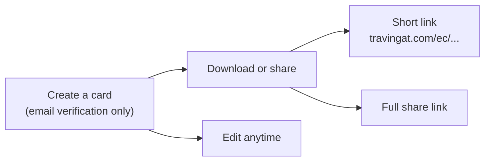
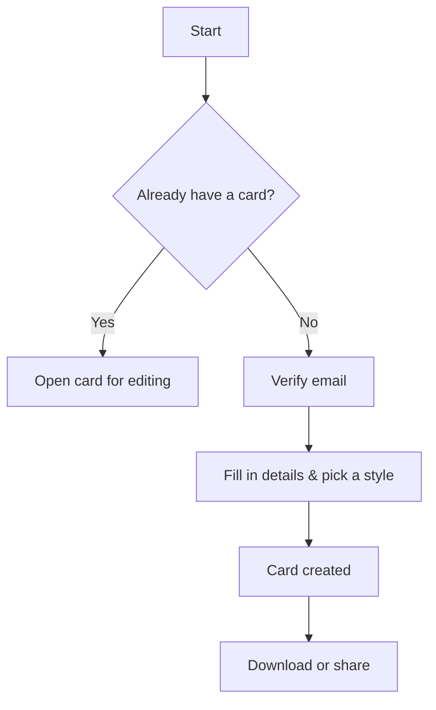

# Explorer Cards — Shareable Travel Passport

An Explorer Card is a shareable "travel passport" — a visual card displaying a traveler's name, home country, a photo, and their list of visited countries, rendered in one of three styles: **Classic**, **Minimal**, and **Adventure**. It's Travingat's lightest-weight product: no full account required, just an email, and a card is ready to share in minutes.

---

## 1. Creating a Card

A visitor verifies their email with a one-time code, then fills out a single form: name, home country, a multi-select list of visited countries (a minimum of five, to keep the card visually meaningful), a profile photo, a cover photo, and a chosen card style. Each of the three styles can have its own independently cropped cover photo, so the card looks intentional no matter which style is shared.

Every visitor gets exactly one card — returning to create a second one instead opens the existing card for editing.

---

## 2. Sharing & Export

A finished card can be downloaded as an image or shared directly via a link — both the short form (ideal for social bios) and a full link are generated automatically for each of the three styles.

- **Download**: produces a high-resolution image of the card exactly as designed, rendered consistently regardless of the device or browser window size.
- **Share**: on mobile, uses the device's native share sheet; on desktop, presents a simple link-copy flow.
- **Download all three styles at once**: bundles all three card designs into a single download for convenience.

Shared links open a public, read-only view of the card — no login required to view.

---

## 3. Why It's Built This Way

- **Anonymous-first**: the only gate is a one-time email code — no password, no lengthy signup — which keeps the entry barrier as low as possible for a feature designed to spread socially.
- **One card per person**: keeps the feature focused and avoids clutter, while editing is always available if details change.
- **Consistent exports**: cards render identically everywhere they're shared, independent of the viewer's screen size, so a card always looks exactly as designed.
- **A stepping stone, not a dead end**: Explorer Cards are a fast, viral entry point into the Travingat ecosystem — many creators who start here go on to apply for a full [Get Featured](/tech-docs/Get-Featured) profile.
