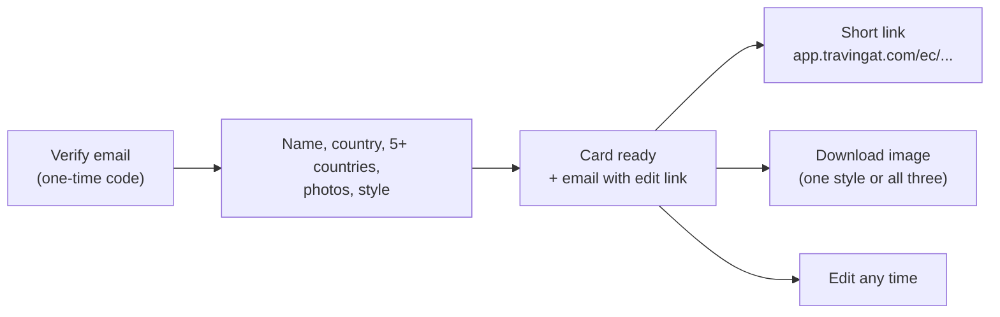
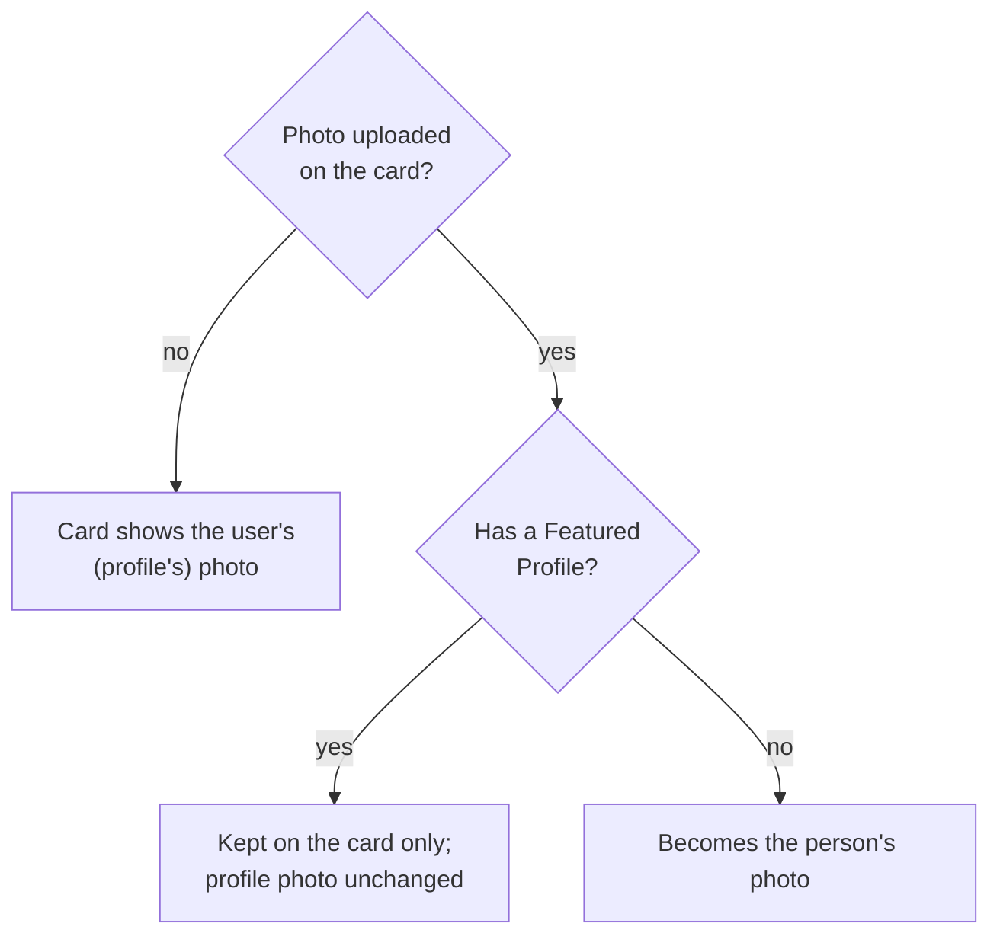

# Explorer Cards — Shareable Travel Passport

An Explorer Card is a shareable "travel passport": the traveler's name, home country, photos and visited countries, in one of three styles, **Classic**, **Minimal** or **Adventure**. It's the lightest Travingat product. You verify an email, fill in one form, and the card is ready to share. No Featured Profile is needed.

---

## 1. Creating and editing

1. The visitor verifies their email with a one-time code. This creates (or signs in to) their user account.
2. They fill in one form:
   - name and home country;
   - **at least five** visited countries;
   - a profile photo and a cover photo (up to 20 MB each);
   - a card style.

   Each style can have its own cover crop, so all three styles look intentional.
3. On submit:
   - the card is saved and its photos are queued for optimisation;
   - an email ("Your Explorer Card is Ready") with an edit link is sent the first time the card is created, at most once every 30 minutes.

Each person has **one card**. Coming back to create one opens the existing card for editing (`/edit/explorercard`, or `/join/explorercard` from the email).

If the person already has a Featured Profile, the form is prefilled from it: name, country, countries and photos.

---

## 2. What the card stores and what it shares

The card shares the person's identity with their profile. Both read it from the user record (see [Data Model](/tech-docs/Data-Model)).

| On the user (shared with the profile) | On the card only |
| :--- | :--- |
| Name, home country | Profile-photo crop (one for all styles) |
| Visited countries | Cover crop for each style |
| Card style, badge | Photos uploaded on the card itself |

### Photos

- **No photo of its own:** the card shows the person's profile photo and cover, and follows any change to them.
- **Photo uploaded on the card, with a profile:** the card keeps it, and the profile's photo is not changed.
- **Profile created after the card:** the profile starts with the card's photos if it was created without its own. After that the two are separate.
- **Resubmitting the photo the form prefilled** doesn't count as uploading a new one.

### Countries

There is one list of visited countries per person. Submitting the card form:
- **with a profile**, only *adds* countries, because each country can hold a photo folder on the profile. A newly added country gets an empty folder.
- **without a profile**, saves the list exactly as picked.

---

## 3. Sharing and download

- **Short link:** `app.travingat.com/ec/<id>-<a|b|c>`, where `a` = Classic, `b` = Minimal and `c` = Adventure. It opens a public, read-only view; no login is needed to look.
- **Download:** a high-resolution image rendered in the browser, identical on every device. "Download all" bundles the three styles into one ZIP file.
- **Share:** the native share sheet on mobile, copy-link on desktop.

---

## 4. Why it's built this way

- **Low friction:** the only gate is an email code, which suits a feature meant to spread.
- **One card per person:** it stays focused, and editing is always available.
- **One identity:** name, country and countries are shared with the profile, so they never disagree. Photos can differ, because a card is often styled differently from a profile.
- **A way in:** many people who start with a card go on to apply for a [Featured Profile](/tech-docs/Get-Featured).

---

## 5. API reference

| Endpoint | Purpose |
| :--- | :--- |
| `POST /api/explorercard` | Create or update the signed-in user's card (multipart; `visitedCountries` is a JSON list) |
| `GET /api/explorercard/<id>` | Read a card by card id, profile id, user id, id prefix or handle |
| `PATCH /api/explorercard/<id>` | Update the badge (owner or admin) |
| `GET /api/explorercard/prefill` | Prefill data from the user's Featured Profile |

The card returns `visited_countries` as display names, `card_style` capitalised (`Classic`), and `cover_crop_data` keyed by style (`{"Classic": ..., "Minimal": ..., "Adventure": ...}`).
