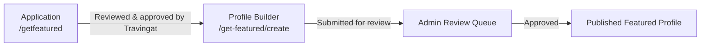
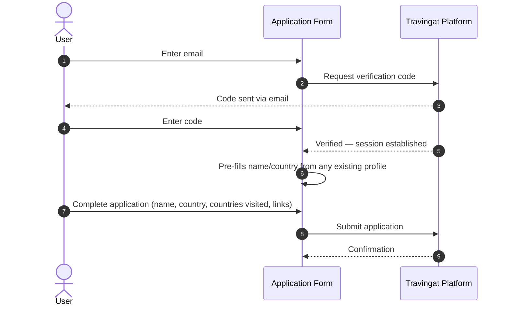
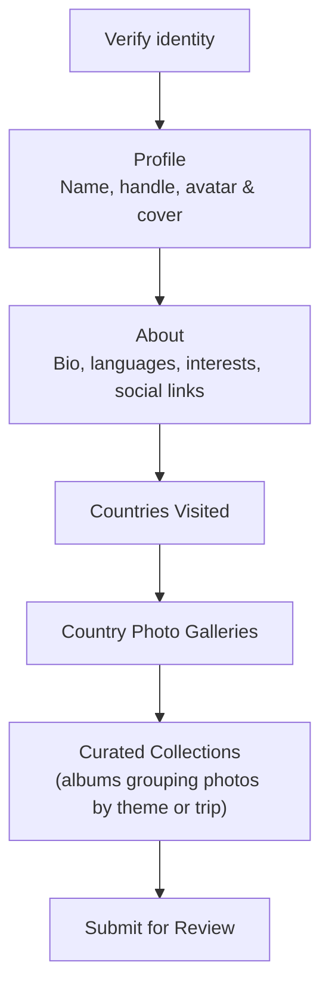
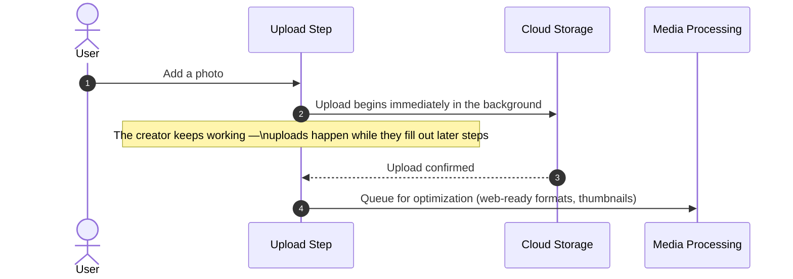
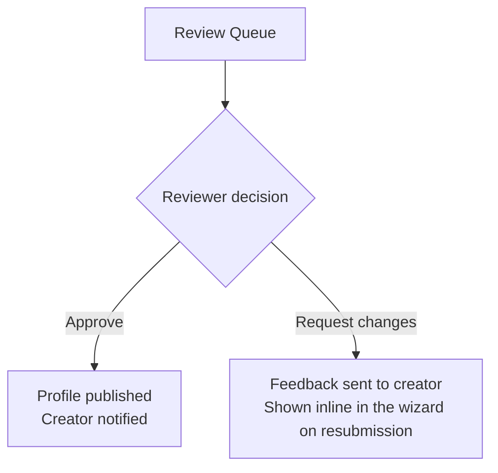

# Get Featured — Creator Application & Profile Builder

"Get Featured" is Travingat's pathway for a traveler to become a published **Featured Profile** — a public creator portfolio on the platform. The experience is split into two purposeful phases: a lightweight **Application**, and a guided **Profile Builder** that only unlocks once an application is approved.

---

## 1. Application

A traveler verifies their email with a one-time code, then fills in a short form — name, home country, number of countries visited, and at least one social/portfolio link. This keeps the entry barrier low: no full account creation, no commitment beyond a few fields.

Submitted applications enter the Travingat review queue, where the team evaluates each one before granting access to the full profile builder.

---

## 2. Profile Builder Wizard

Once an application is approved, the creator receives access to `/get-featured/create` — a guided, multi-step wizard that produces the final published profile. Every step can be saved as a draft and resumed later, so the creator is never forced to finish in one sitting.

| Step | Purpose |
| :--- | :--- |
| **Profile** | Name, handle, avatar and cover image with built-in cropping |
| **About** | Bio, current location, languages, interests, social links |
| **Countries** | The list of countries the creator has visited |
| **Photos** | A photo gallery for each visited country |
| **Collections** | Curated albums that group photos by trip or theme, each with its own description and country tags |

A creator can leave at any point via **Save & Exit**, and return later exactly where they left off — their in-progress wizard state, including every photo and selection made so far, is restored automatically. If a submission needs changes, the specific feedback is shown directly in the wizard so the creator knows exactly what to update before resubmitting.

---

## 3. Media Upload

Photos are uploaded directly from the browser to Travingat's cloud storage, bypassing the application server entirely — this keeps uploads fast and keeps server load independent of how many photos a creator adds.

Key characteristics of the upload experience:

- **Uploads start the instant a photo is added**, not when the wizard is finally submitted — by the time a creator reaches the final step, most or all of their photos are already uploaded, so submission is fast.
- **A 20 MB per-file size limit** keeps uploads quick and consistent across devices.
- Every uploaded photo is automatically run through Travingat's media optimization pipeline, producing web-ready, compressed versions and thumbnails for fast loading everywhere the profile is shown. See the [Media Engine](/tech-docs/Media-Engine) doc for the full pipeline.

> **Video uploads are not yet enabled for creators in this release.** The upload interface currently accepts photos only; video support is planned for a future release.

---

## 4. Admin Review

Every submitted profile enters a review queue inside the Travingat team dashboard. A reviewer sees the complete profile exactly as the creator built it, and can:

- **Approve** — the profile is published immediately, and the creator is notified automatically.
- **Request changes** — the creator receives specific, actionable feedback and can resubmit directly from the wizard.

This two-sided loop — clear admin feedback paired with an easy resubmission path — keeps the approval process collaborative rather than a one-shot pass/fail gate.

---

## 5. Why It's Built This Way

- **Low-commitment entry, high-quality output.** The short application filters intent before anyone invests time in the full builder; the builder itself is thorough enough to produce a genuinely polished public profile.
- **Never lose progress.** Every step autosaves, so a creator can build their profile across multiple sessions without friction.
- **Fast by design.** Starting uploads the moment a photo is added — rather than batching everything at the end — means submission feels instant even for profiles with dozens of photos.
- **A real feedback loop, not a black box.** Rejected submissions come back with specific reasons, turning review into a collaborative step rather than a dead end.
