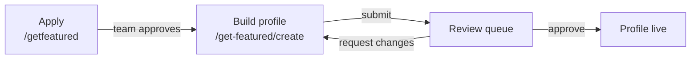
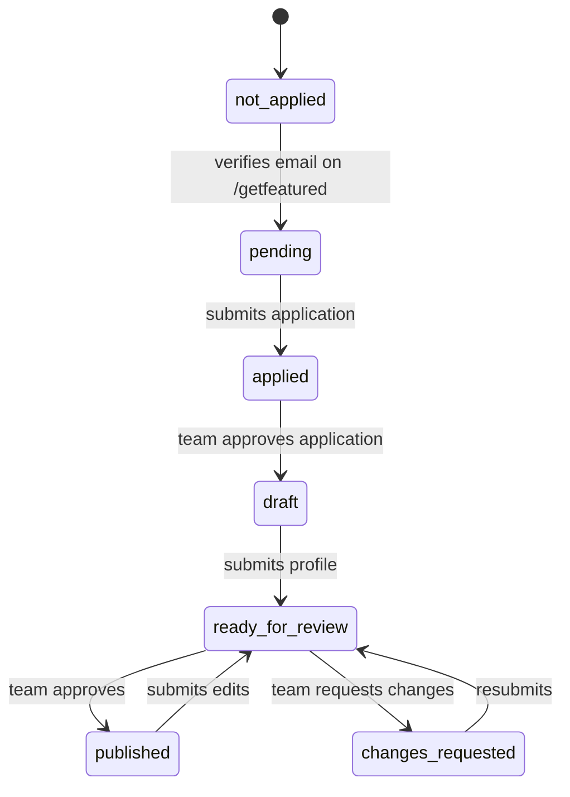
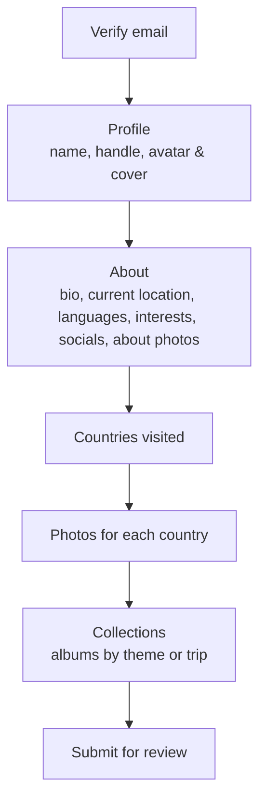
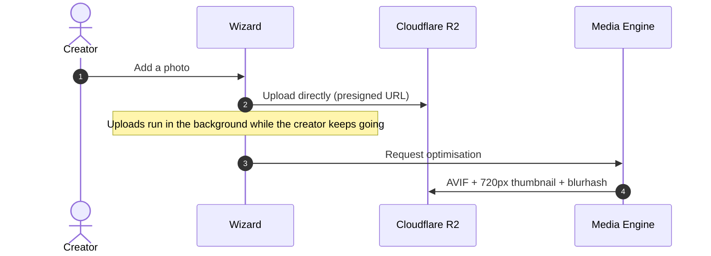

# Get Featured — Creator Application & Profile Builder

"Get Featured" is how a traveler becomes a published **Featured Profile**, a public creator portfolio at `app.travingat.com/<handle>`. It has two phases: a short **application**, then a guided **profile builder** that opens only after the application is approved.

---

## 1. Status lifecycle

One set of statuses is used everywhere: the waitlist entry (`get_featured_status`) and the profile (`review_status`).

| Status | Meaning |
| :--- | :--- |
| `not_applied` | Never started Get Featured (for example, only joined the waitlist or made an Explorer Card) |
| `pending` | Verified their email on `/getfeatured` but hasn't sent the application |
| `applied` | Application sent; waiting for the team |
| `draft` | Application approved; building the profile |
| `ready_for_review` | Profile submitted for review |
| `changes_requested` | The team asked for changes; the creator edits and resubmits |
| `published` | Live |

---

## 2. Application

The traveler verifies their email with a one-time code, then sends a short form: name, home country, number of countries visited, and their social or portfolio links. The fields are prefilled from any existing card or profile. A snapshot of exactly what they sent is kept on the waitlist entry (`featured_application`), so later edits elsewhere don't change what the reviewer sees.

The team sees applications in admin under **Featured Requests**. Approving one sends "You've been selected to get featured on Travingat" with a link to the profile builder. Declining sends an email explaining why.

### Coming back to the application page

On the application page (`/get-featured` on `app.travingat.com`, or the Framer component on `travingat.com`), an approved applicant gets what `GET /api/get-featured/prefill` says, whether they arrive with an active session or have just entered a one-time code. Approving an application doesn't create a profile (the builder's first save does), so `has_existing_profile` false means nothing has been saved yet:

| Builder data | Shown |
| --- | --- |
| Nothing saved yet (`has_existing_profile` false) | No status: straight into the builder (`/get-featured/create`) |
| Saved progress and still editable, or the data can't be read | **Continue your profile**, with "Continue editing" and "Use a different email" |
| `ready_for_review` | **Your profile has been submitted!** |
| `published` and locked (`can_edit` false) | **Your profile is live**, with a link to it |

The rules live in `features/getfeatured/session-status.ts` and are mirrored in the Framer component. The illustrations are in `landing/public/icons/get-featured/`.

### The approval link

The link is `app.travingat.com/auth/link?token=…` (emails sent before 2026-11-27: `/get-featured/auth?token=…`, same handler), a one-time token that lasts 7 days (sending the email again replaces it). The "changes requested" email's **Update your profile** button uses the same kind of link. It signs in the email it was sent to, never whichever account is signed in on that browser. Once that email is signed in, a **newly approved applicant (nothing saved yet) goes straight into the builder**; anyone with saved progress, a submitted or a live profile lands on `travingat.com/get-featured` and its status (**Continue your profile** opens the builder at the last saved step). If the builder data can't be read, the link lands on the page.

| On the browser | Opening the link |
| --- | --- |
| The invited email already signed in | Straight on (the builder, or the page if there's saved progress); the token stays unused |
| A different email signed in | Signs it out (its session ends on the server too) and asks the invited email for a one-time code, prefilled. The token stays unused |
| Nobody signed in, link unused | Signs the invited email in (the token is used up). No code: the link proves the email |
| Nobody signed in, link already used or expired | Asks the invited email for a one-time code, prefilled |
| Unknown link, or an email that is no longer approved | The page, signed out |

For the code cases the email is passed as `#email=…`, which stays in the browser; the Framer component fills it in and removes it from the address bar. On any host other than `app.travingat.com` (local, test servers) the link ends on that app's own `/get-featured` instead.

This is the product-wide session rule (Architecture, section 7). The landing route asks the backend which email a token belongs to first (`POST /api/auth/magic-link-info`, which doesn't use it up), and it expires every copy of the session cookies (host-only and `Domain=.travingat.com`) before setting new ones. A browser holding both used to send the older one first, so the link could land in the previous account.

---

## 3. Profile builder

`/get-featured/create` is a step-by-step wizard. Every step can be saved and resumed later.

| Step | What the creator adds |
| :--- | :--- |
| **Profile** | Name, handle (Instagram-style: letters, numbers, `.` and `_`), avatar and cover with cropping |
| **About** | Bio, current location, languages, interests, social links, about photos |
| **Countries** | The countries they've visited |
| **Photos** | A photo folder for each country (up to 30 photos per country) |
| **Collections** | Albums with a title, description, countries and photos (up to 30 per collection) |

- **Save & Exit** keeps everything, and the creator picks up where they left off.
- **Back on the first step** (or the browser's back button) asks "Leave the application?". **Leave** signs the creator out and goes to `travingat.com/get-featured`.
- **Change requests:** if the team asked for changes, the reason is shown in the wizard.
- **Editing a live profile:** submitting the edits sends it back for review. Re-saving a profile never deletes photos it already has; only the sections being changed are replaced.

The profile's name, country, photos and countries are stored on the person's user record and shared with their Explorer Card. The profile itself holds the handle, bio, socials, photos and collections. See [Data Model](/tech-docs/Data-Model).

---

## 4. Photo uploads

- **Uploads start as soon as a photo is added**, so submitting is quick even with many photos.
- **Limits:** photos only (no video yet), up to 20 MB each.
- **Processing:** every photo is optimised by the [Media Engine](/tech-docs/Media-Engine).

---

## 5. Review

Submitted profiles appear in admin under **Profiles → Review**, filterable by status. The reviewer sees the profile as the creator built it, then either:

- **approves** it: the profile goes live and the creator gets "Your profile is now live on Travingat!"; or
- **requests changes** with a reason: the creator gets "Action required: updates needed for your Travingat profile" and sees the reason in the wizard.

The queue only shows real submissions. Sample profiles made in the admin editor never appear in it.

---

## 6. Why it's built this way

- **The short application filters intent** before anyone spends time on the full builder.
- **Progress is never lost:** drafts save at every step.
- **Fast submission:** photos upload while the creator works, not at the end.
- **Review is a conversation:** change requests come with a reason and an easy way to resubmit.
