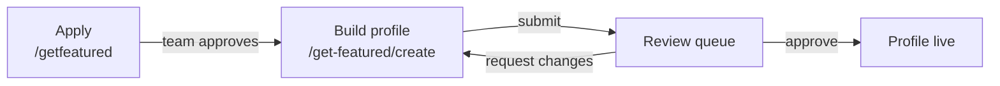
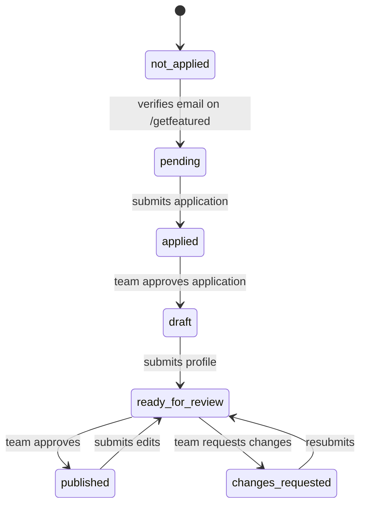
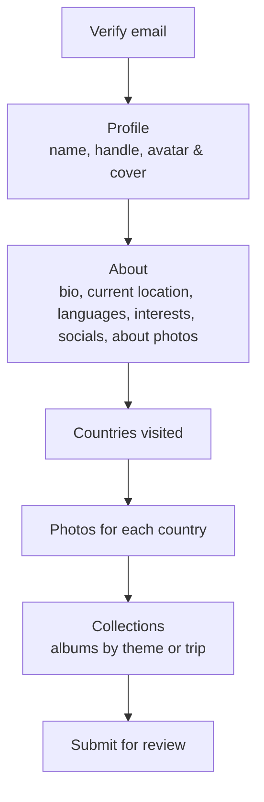
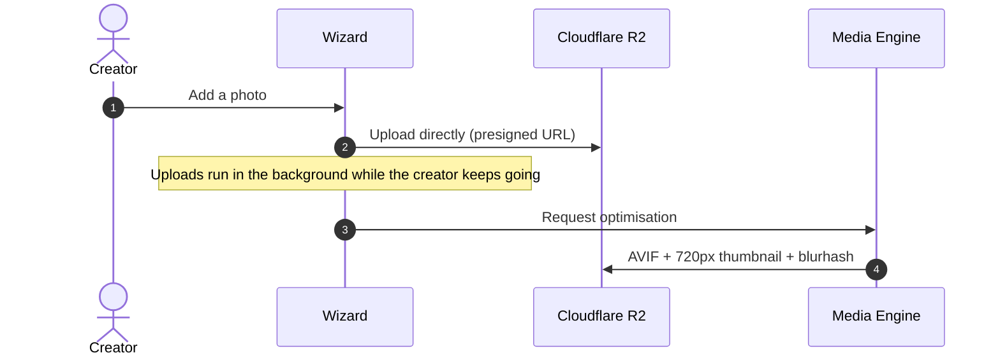

# Get Featured — Creator Application & Profile Builder

"Get Featured" is how a traveler becomes a published **Featured Profile**, a public creator portfolio at `app.travingat.com/<handle>`. It has two phases: a short **application**, then a guided **profile builder** that opens only after the application is approved.

---

## 1. Status lifecycle

One set of statuses is used everywhere: the waitlist entry (`get_featured_status`) and the profile (`review_status`).

| Status | Meaning |
| :--- | :--- |
| `not_applied` | Never started Get Featured (for example, only joined the waitlist or made an Explorer Card) |
| `pending` | Verified their email on `/getfeatured` but hasn't sent the application |
| `applied` | Application sent; waiting for the team |
| `draft` | Application approved; building the profile |
| `ready_for_review` | Profile submitted for review |
| `changes_requested` | The team asked for changes; the creator edits and resubmits |
| `published` | Live |

---

## 2. Application

The traveler verifies their email with a one-time code, then sends a short form: name, home country, number of countries visited, and their social or portfolio links. The fields are prefilled from any existing card or profile. A snapshot of exactly what they sent is kept on the waitlist entry (`featured_application`), so later edits elsewhere don't change what the reviewer sees.

The team sees applications in admin under **Featured Requests**. Approving one sends "You've been selected to get featured on Travingat" with a link to the profile builder. Declining sends an email explaining why.

---

## 3. Profile builder

`/get-featured/create` is a step-by-step wizard. Every step can be saved and resumed later.

| Step | What the creator adds |
| :--- | :--- |
| **Profile** | Name, handle (Instagram-style: letters, numbers, `.` and `_`), avatar and cover with cropping |
| **About** | Bio, current location, languages, interests, social links, about photos |
| **Countries** | The countries they've visited |
| **Photos** | A photo folder for each country (up to 30 photos per country) |
| **Collections** | Albums with a title, description, countries and photos (up to 30 per collection) |

- **Save & Exit** keeps everything, and the creator picks up where they left off.
- **Change requests:** if the team asked for changes, the reason is shown in the wizard.
- **Editing a live profile:** submitting the edits sends it back for review. Re-saving a profile never deletes photos it already has; only the sections being changed are replaced.

The profile's name, country, photos and countries are stored on the person's user record and shared with their Explorer Card. The profile itself holds the handle, bio, socials, photos and collections. See [Data Model](/tech-docs/Data-Model).

---

## 4. Photo uploads

- **Uploads start as soon as a photo is added**, so submitting is quick even with many photos.
- **Limits:** photos only (no video yet), up to 20 MB each.
- **Processing:** every photo is optimised by the [Media Engine](/tech-docs/Media-Engine).

---

## 5. Review

Submitted profiles appear in admin under **Profiles → Review**, filterable by status. The reviewer sees the profile as the creator built it, then either:

- **approves** it: the profile goes live and the creator gets "Your profile is now live on Travingat!"; or
- **requests changes** with a reason: the creator gets "Action required: updates needed for your Travingat profile" and sees the reason in the wizard.

The queue only shows real submissions. Sample profiles made in the admin editor never appear in it.

---

## 6. Why it's built this way

- **The short application filters intent** before anyone spends time on the full builder.
- **Progress is never lost:** drafts save at every step.
- **Fast submission:** photos upload while the creator works, not at the end.
- **Review is a conversation:** change requests come with a reason and an easy way to resubmit.
