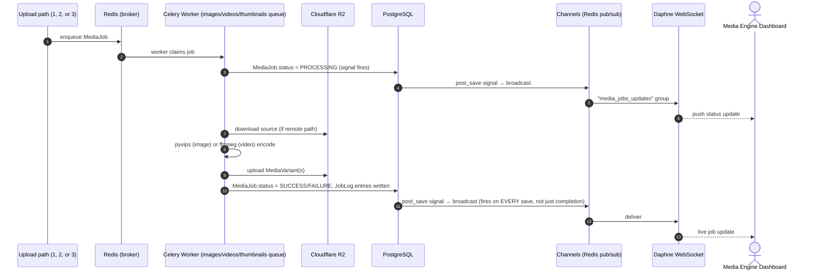

# Media Engine — How It Works

This doc documents the **real, verified-against-source** implementation of the media processing pipeline backing the Media Engine dashboard (`/media-engine`) and Media Portal sandbox (`/media-portal`) in this app. It supersedes the pipeline description in [Techstack.md §5](/tech-docs/Techstack) wherever the two disagree — several details there (format, queues, and the devportal sandbox expiry) turned out to be stale or aspirational rather than current behavior. Corrections are called out explicitly below rather than silently fixed, so you can see what changed.

---

## 1. Where the code lives

The pipeline is implemented across **two separate Django apps** in the `backend` repo — not one unified "media" app:

| App | Role | Key files |
| :--- | :--- | :--- |
| `media_engine/` | The production pipeline | `models.py`, `tasks.py`, `views.py`, `serializers.py`, `consumers.py`, `urls.py`, `admin.py`, `services/image_processor.py`, `services/video_processor.py`, `services/storage.py`, `management/commands/purge_test_media.py` |
| `devportal/` | The sandbox upload path used by this app's Media Portal | `models.py` (`DevportalImageUpload`, `ServiceSubscription`, `UserStorage`), `views.py`, `tasks.py`, `storage.py` |

Celery app config, task routing, and the beat schedule live in `core/celery.py` / `core/settings.py`.

---

## 2. There is no single "upload" flow — there are three

This is the most important correction to make up front: the clean "presign → direct R2 PUT → confirm → process" story is accurate for **exactly one** of three real ingestion paths — the devportal sandbox. Production creator media gets into the pipeline differently.

```mermaid
flowchart TD
    subgraph Path1["1. Direct multipart upload (admin/internal)"]
        A1["Client POSTs multipart file\ndirectly to Django API"] --> A2["MediaViewSet.create()\n(auth: IsAdminUser)"]
        A2 --> A3["StorageService.save_file()\n(Django default_storage)"]
        A3 --> A4["process_image_task.delay() /\nprocess_video_task.delay()"]
    end

    subgraph Path2["2. Remote pull-and-replace (the real production path)"]
        B1["Creator media already sits in R2\n(profile/avatar/gallery image URL)"] --> B2["MediaViewSet.remote() action\nor scan_unoptimized_media_task (cron)"]
        B2 --> B3["Create MediaAsset row"]
        B3 --> B4["process_remote_media_task.delay()"]
        B4 --> B5["Download from R2 → process locally\n→ re-upload to SAME bucket as .avif/.webm\n→ delete old unoptimized key"]
    end

    subgraph Path3["3. Devportal sandbox presign (Media Portal UI only)"]
        C1["POST /api/internal/devportal/media/presign"] --> C2["Presigned PUT URL,\ntargets travingat-assets bucket"]
        C2 --> C3["Browser PUTs directly to R2"]
        C3 --> C4["POST /api/internal/devportal/media/process"]
        C4 --> C5["DevportalImageUpload record\n(NOT a MediaAsset — separate model)"]
    end
```



- **Path 1 (direct multipart)**: a client POSTs a file straight to the Django API (`IsAdminUser`-gated, not public), saved via `StorageService.save_file` against `default_storage`, then queues `process_image_task`/`process_video_task`.
- **Path 2 (remote pull-and-replace — the actual production flow)**: for creator media already living in the `travingat` R2 bucket (avatars, gallery photos, etc.), `MediaViewSet.remote()` or the cron-driven `scan_unoptimized_media_task` creates a `MediaAsset` row and queues `process_remote_media_task`, which downloads the object from R2, processes it, **re-uploads it back to the same bucket** with the unoptimized key replaced by `.avif`/`.webm`, and deletes the old key. There is no client "confirm upload" step in this path at all — it's entirely server/cron-driven.
- **Path 3 (devportal sandbox)**: the only path that actually matches the classic presign-to-R2 pattern, and it targets the **separate `travingat-assets` bucket**, using a completely different model (`DevportalImageUpload`, not `MediaAsset`).

> **Correction:** Techstack.md's unified "presign → direct R2 PUT → confirm → MediaAsset → Celery" sequence is only accurate for Path 3. It does not describe how production creator media actually enters the pipeline.

---

## 3. Data model (`media_engine/models.py`)

```mermaid
erDiagram
    MediaAsset ||--o{ MediaVariant : produces
    MediaAsset ||--o{ MediaJob : processes
    MediaJob ||--o{ JobLog : records

    MediaAsset {
        uuid id
        fk user
        string original_filename
        string original_content_type
        string media_type "IMAGE | VIDEO"
        string status "UPLOADING | PROCESSING | DONE | ERROR"
        string upload_batch_id
        int original_size
        int original_width
        int original_height
        float original_duration
        string blurhash
        string raw_storage_path
        string remote_key "indexed"
        datetime deleted_at "soft delete"
        string delete_reason
    }
    MediaVariant {
        uuid id
        fk media
        string variant_type "OPTIMIZED | THUMBNAIL_720"
        string storage_path
        string content_type
        int width
        int height
        float duration
        int file_size
        int quality
    }
    MediaJob {
        uuid id
        fk media
        string job_type "IMAGE_PROCESSING | VIDEO_PROCESSING | THUMBNAIL_PROCESSING | RAW_CLEANUP"
        string status "PENDING | PROCESSING | SUCCESS | FAILURE | RETRYING"
        int attempts
        string error_message
    }
    JobLog {
        fk job
        string stage
        string message
        datetime timestamp
    }
```

- `MediaAsset` has two managers: `objects` (excludes soft-deleted rows) and `all_objects` (includes everything — used by restore).
- `MediaVariant` has a unique constraint on `(media, variant_type)` — **only one thumbnail size exists, `THUMBNAIL_720`**, not a generic set of sizes.
- Django `post_save` signals on both `MediaJob` and `JobLog` broadcast to Channels on **every save**, not just on completion (see §6).

---

## 4. What the encoders actually do

### 4.1 Images — pyvips only, output is AVIF (not WebP)

> **Correction:** the optimized output format is **AVIF only**. Thumbnails are also AVIF, and there is only one thumbnail size (720px). "WebP/AVIF" in the older doc is wrong on both counts. Pillow is **not** part of the optimization encode path at all — it's used only for blurhash generation and an unrelated crop endpoint (`DynamicCropAPIView`).

- Encoder: `image.heifsave_buffer(Q=q, compression="av1", effort=5)` (pyvips).
- **Quality ladder**: tries `[95, 85, 75, 70]` in order, stopping at the first output ≤ `MAX_IMAGE_OUTPUT_SIZE_MB` (default **2 MB**).
- **Avatar/cover/profile override**: if the filename or storage key contains `avatar`, `cover`, or `profile`, the ladder is skipped entirely — forced to **Q95 only**, no compression trade-off.
- **Small-file skip**: images under `IMAGE_MIN_OPTIMIZATION_SIZE_BYTES` (default **250 KB**) skip resizing but are still AVIF-encoded, at Q90.
- **Resize cap**: 1920×1080, never upscaled.
- **Thumbnail**: `THUMBNAIL_720` only, AVIF, quality 90 (95 for avatar/cover/profile).
- **Blurhash**: PIL resizes to 64×64, `blurhash.encode(x_components=4, y_components=4)`, stored on `MediaAsset.blurhash`.

### 4.2 Video — ffmpeg + AV1 + Opus, output WebM

> **Correction / addition:** the video pipeline wasn't detailed in the older doc at all. It shells out to **ffmpeg/ffprobe via `subprocess`** — not any Python video library — encoding with **libsvtav1 (AV1 video)** and **libopus (audio)** into a **WebM** container.

- **Quality → CRF mapping**: `{95: 30, 85: 35, 75: 42, 70: 50}`, encode preset `8`.
- **Resize cap**: 1920×1080, same as images.
- **Small-file skip**: videos under `VIDEO_MIN_OPTIMIZATION_SIZE_BYTES` (default **2 MB**) are stored unmodified.
- **"Don't make it worse" fallback**: if a re-encode comes out **larger** than the original, the original file is kept as-is, in its original container — this safety net isn't mentioned anywhere in the older doc.

### 4.3 Real size limits (from settings)

| Setting | Default |
| :--- | :--- |
| `MAX_IMAGE_SIZE_MB` | 25 |
| `MAX_VIDEO_SIZE_MB` | 500 |
| `MAX_IMAGE_OUTPUT_SIZE_MB` | 2 |
| `MAX_VIDEO_OUTPUT_SIZE_MB` | 50 |
| `IMAGE_MIN_OPTIMIZATION_SIZE_BYTES` | 250 KB |
| `VIDEO_MIN_OPTIMIZATION_SIZE_BYTES` | 2 MB |
| `RAW_RETENTION_HOURS` | 24 |

---

## 5. Celery queues, routing & retries

> **Correction:** there are **four** queues, not three — the older doc's "images • thumbnails • maintenance • beat" list is missing `videos`.

| Queue | Handles |
| :--- | :--- |
| `images` | Image processing, remote processing, reprocess |
| `videos` | Video processing (**missing from the old doc entirely**) |
| `thumbnails` | Thumbnail generation |
| `maintenance` | Raw cleanup, undo, both orphan/unoptimized scan tasks, DB backup, devportal reconcile/cleanup |

**Retries**: `max_retries=3`, exponential backoff `countdown = 2 ** retries`. Two deliberate exceptions skip retry entirely:
- Corrupt/unreadable source files (matched against a hardcoded list of known libvips/JPEG error strings) — the asset is immediately soft-deleted into the recycle bin instead of retried.
- `404` from R2 in the remote-pull flow (Path 2) — the referenced object is gone, retrying won't help.



---

## 6. Job lifecycle, idempotency & stale-job reconciliation

- **`MediaAsset.status`**: `UPLOADING → PROCESSING (implicit) → DONE | ERROR`.
- **`MediaJob.status`**: `PENDING → PROCESSING → SUCCESS | FAILURE | RETRYING`, `attempts` incremented per retry, old `JobLog` entries wiped on each retry.
- **Idempotency**: tasks check for an existing `OPTIMIZED` variant (or the specific thumbnail) before reprocessing and short-circuit with an "Already processed" log entry — safe to re-trigger a job without double-billing storage or compute.
- **Stale-job reconciliation is real and already implemented**: `MediaJobViewSet.reconcile_stale()` finds jobs stuck `PROCESSING` for more than 30 minutes and either:
  - auto-marks them `SUCCESS` if the expected variants already exist in storage (worker likely crashed *after* finishing), or
  - marks them `FAILURE` with `"Task timed out or Celery worker process terminated unexpectedly."`
- **`purge-failed`**: bulk-deletes jobs/assets matching known 404/HeadObject-error patterns, or zero-byte dummy assets.

---

## 7. WebSocket broadcast (`media_engine/consumers.py`)

- Consumer: `MediaJobConsumer`. Group: `"media_jobs_updates"` (confirmed — matches the older doc).
- **Auth is custom, not JWT**: the WS handshake is accepted unconditionally, then the consumer checks either (a) the connecting IP is in an internal/private subnet (Docker-internal proxying), or (b) a signed `admin_session`/`cms_session` cookie (`TimestampSigner`, 24h max age) — closing with code `4401` if neither holds.
- **Payload**, broadcast on every `MediaJob` or `JobLog` save: `{ "type": "job_update", "job": <MediaJobSerializer data> }`.

---

## 8. Scheduled jobs (real `CELERY_BEAT_SCHEDULE`)

| Task | Schedule | Purpose |
| :--- | :--- | :--- |
| `media_engine.tasks.cleanup_raw_media_task` | hourly (`minute=0`) | Deletes raw/unprocessed files older than `RAW_RETENTION_HOURS` (24h) |
| `core.celery.backup_db_to_r2_task` | hourly (`minute=0`) | `pg_dump -Fc` → stream to R2 (`core/db_backup.py`), `max_retries=3`, 120s retry backoff |
| `devportal.reconcile_user_storage` | daily at 03:00, `apply=False` | Reconciles per-user storage byte counters against actual R2 state |
| `devportal.cleanup_expired_images` | every 5 minutes | Expires devportal sandbox uploads — **see correction below** |

> **Correction (fixed 2026-11-03) — devportal sandbox uploads are permanently stored, by design, not 15-minute:** the `DevportalImageUpload` model's docstring claimed uploads were "live for 15 minutes," and the older Techstack doc repeated that claim. In the real processing task (`devportal/tasks.py:process_devportal_image_upload_task`), the code explicitly sets `upload.expires_at = None  # Permanent!` and logs `"Stored permanently"` — this is a deliberate decision, not leftover/half-migrated code. The model's docstring has been corrected to say so. `expires_at`/`EXPIRED` and the 5-minute `cleanup_expired_devportal_images_task` beat job remain in place only as a safety net for any legacy record that might still carry an explicit expiry — normal uploads never hit it, and that's expected.

---

## 9. Soft delete, hard delete & storage accounting

```mermaid
flowchart LR
    Asset["MediaAsset"] -->|soft_delete()| Recycle["deleted_at set,\nexcluded from default manager\n(Recycle Bin)"]
    Recycle -->|restore()| Asset
    Recycle -->|hard_delete()| Purge["Deletes raw file + every\nMediaVariant from storage,\nthen deletes the DB row"]
    Asset -.->|every soft_delete / restore /\nsuccessful processing| Storage["devportal.services.record_upload /\nrecord_delete → UserStorage counter"]
```

- **Soft delete**: `MediaAsset.soft_delete()` sets `deleted_at`/`delete_reason`. The default `objects` manager excludes these everywhere, including `MediaJobViewSet`'s own queryset (`media__deleted_at__isnull=True`).
- **Restore**: fetched via `all_objects.get()`, then `.restore()`.
- **Hard delete**: explicitly deletes the raw file **and every variant** from storage before deleting the DB row — real cascading cleanup, not just a row delete.
- **Per-user storage accounting** (not mentioned in the older doc at all): soft-delete, restore, and successful processing all call into `devportal.services.record_delete`/`record_upload` to keep a running `UserStorage` byte counter per user in sync, reconciled nightly against actual R2 state.

### "Orphan scanning" — what it actually scans

> **Correction:** `scan_unoptimized_media_task` doesn't find storage objects with no DB reference (that's a separate `OrphansAPIView` living in `profiles.views`, imported directly into `media_engine/urls.py`, not independently verified here). What it actually does: walks every `User`/`FeaturedProfile`/`ExplorerCard`/gallery/collection image URL field in the database, finds any pointing at R2 that is **not already** `.avif`/`.webm`, and queues `process_remote_media_task` for it — skipping assets that already have a non-`ERROR` `MediaAsset`, skipping after 3 prior failures, and verifying existence via `head_object` first. `scan_missing_thumbnails_task` does the equivalent sweep for `THUMBNAIL_720`.

---

## 10. Storage backend

`StorageService` wraps Django's `default_storage`, configured as `S3Boto3Storage` pointed at **the same R2 bucket** (`R2_BUCKET_NAME`, default `travingat`) for raw, optimized, and thumbnail storage. Code comments reference "MinIO" — this is a dev-environment naming leftover; `MINIO_*` settings are literal fallbacks for `R2_*` settings using the same S3-compatible client, not a separate storage backend in production.

---

## 11. Auth on the pipeline's own endpoints

`IsAdminUser` (the permission class gating Path 1 direct uploads and most `media_engine` views) checks bearer tokens in addition to admin-session cookie auth.

> **Fixed (2026-11-03):** this previously accepted a literal production secret hardcoded in source (`"travingat-devportal-prod-secret-2026"`), alongside `settings.DEVPORTAL_API_TOKEN` and the well-known local-dev default token — meaning the real prod credential lived in source control regardless of env configuration. It now checks only `settings.DEVPORTAL_API_TOKEN` (env-driven, matching the pattern already used by `devportal/auth.py`), and the dev-default token is accepted **only when `DEBUG=True`**, so it can never authenticate a production request even if `DEVPORTAL_API_TOKEN` is accidentally left unset there.

---

## 12. Confirmed package versions (`requirements.txt`)

| Package | Version |
| :--- | :--- |
| Django | 4.2.30 |
| djangorestframework | 3.16.1 |
| Celery | ≥5.3.4 |
| pyvips | ≥2.2.3 |
| Pillow | ≥10.1.0 |
| blurhash-python | 1.2.2 |
| channels | 4.3.2 |
| channels_redis | 4.3.0 |
| daphne | 4.2.3 |
| boto3 | 1.34.0 |
| django-storages | ≥1.14.2 |
| psycopg2-binary | 2.9.9 |
| djangorestframework-simplejwt | 5.3.1 |
| sentry-sdk | ≥2.73.0 |
| django-prometheus | ≥2.5.0 |

These match the older Techstack doc's version table closely — the corrections in this doc are about **pipeline behavior**, not package versions.

---

## 13. Summary of corrections vs. the original Techstack.md pipeline description

| Old claim | Reality |
| :--- | :--- |
| Single presign → R2 PUT → confirm → process flow for all media | Only true for the devportal sandbox (Path 3). Production media uses direct multipart upload (Path 1) or server-side remote pull-and-replace (Path 2). |
| Optimized variants are "WebP/AVIF" | AVIF only. |
| "720p thumbnails" (plural, implying multiple sizes) | One size only: `THUMBNAIL_720`. |
| Queues: images • thumbnails • maintenance • beat | Four queues: images • **videos** • thumbnails • maintenance (beat is the scheduler, not a worker queue). |
| No video pipeline mentioned | ffmpeg + libsvtav1 (AV1) + libopus → WebM, independent CRF ladder, "don't make it worse" fallback. |
| Devportal sandbox uploads expire after 15 minutes | Permanent by design (`expires_at = None  # Permanent!`) — the stale model docstring claiming a 15-minute expiry has been corrected. |
| Pillow used for "image header inspection, metadata extraction" generally | Pillow's only live role in the optimization path is blurhash generation; actual encoding is pyvips (images) / ffmpeg (video) only. |
