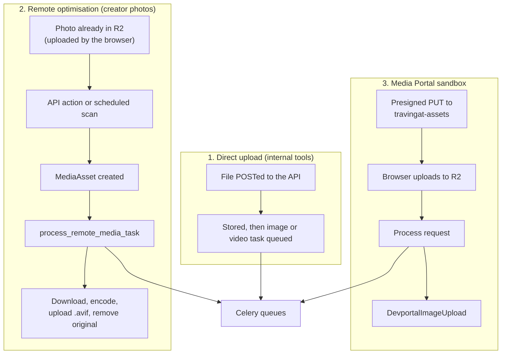
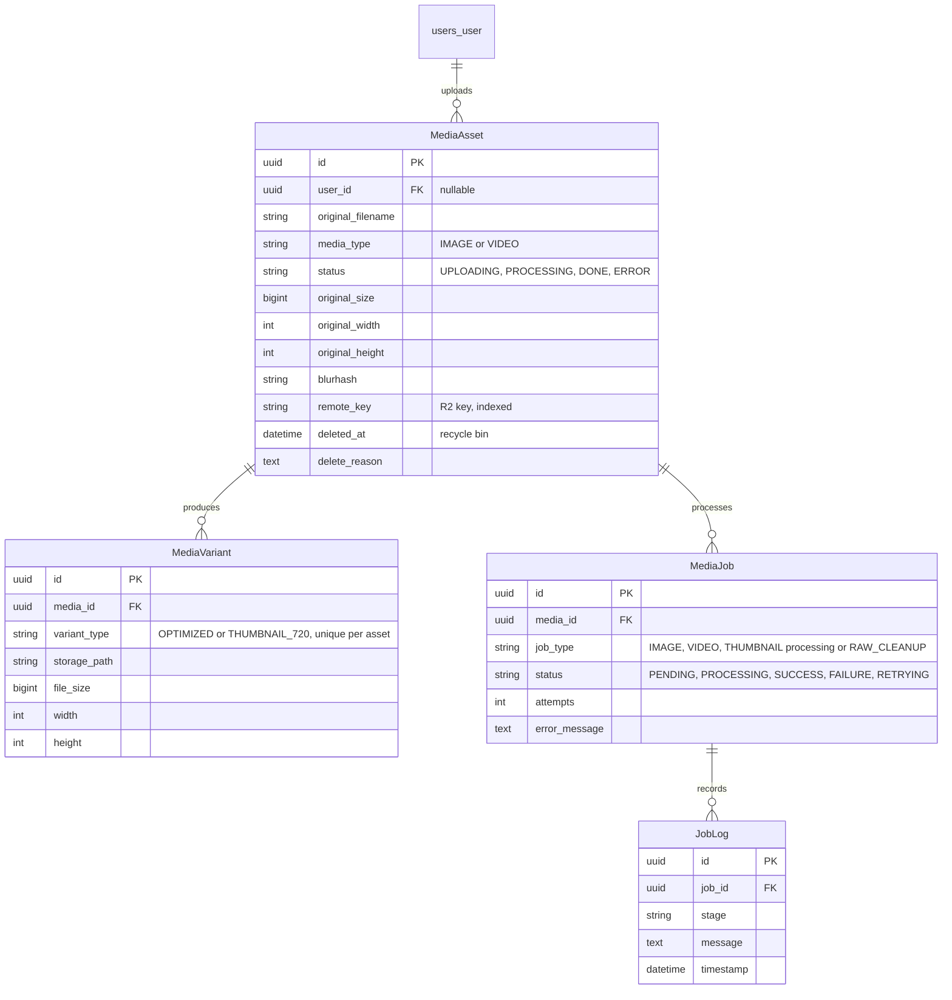
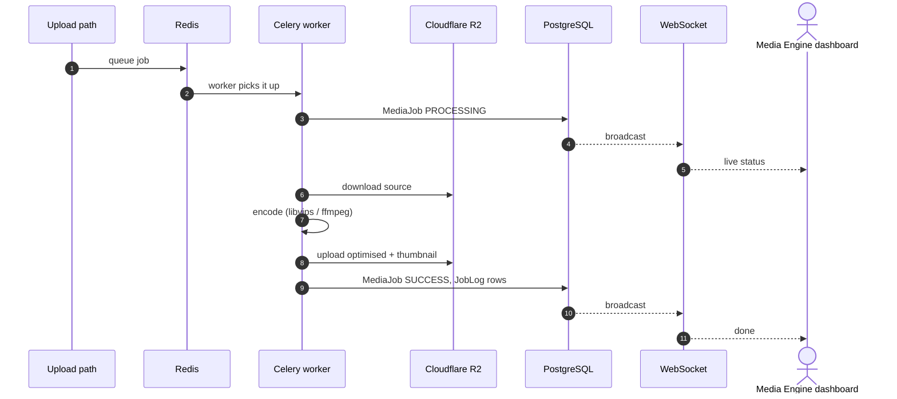
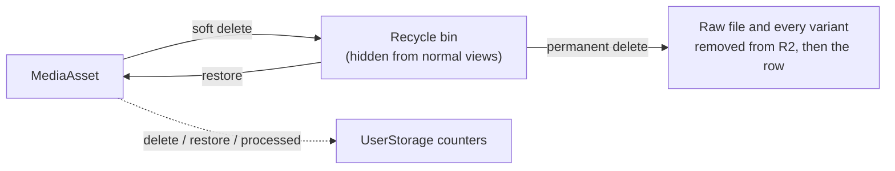

# Media Engine — Processing Pipeline

The Media Engine turns uploaded media into compact, web-ready files. Photos become AVIF with a 720px thumbnail and a blurhash placeholder. Job progress is shown live on the devportal **Media Engine** dashboard (`/media-engine`), and the **Media Portal** (`/media-portal`) is a sandbox for testing the pipeline.

> **Video:** the backend can encode video (AV1 + Opus, WebM), but creators can only upload images today, and production has no worker for the `videos` queue. Add one before video is switched on.

---

## 1. Where the code lives

| Backend app | Role | Key files |
| :--- | :--- | :--- |
| `media_engine/` | The production pipeline | `models.py`, `tasks.py`, `views.py`, `consumers.py`, `services/image_processor.py`, `services/video_processor.py`, `services/storage.py` |
| `devportal/` | The Media Portal sandbox and storage accounting | `models.py` (`DevportalImageUpload`, `UserStorage`, `ServiceSubscription`), `views.py`, `tasks.py`, `services.py` |

Queue routing (`CELERY_TASK_ROUTES`) and the schedule (`CELERY_BEAT_SCHEDULE`) are in `core/settings.py`; the Celery app is `core/celery.py`.

---

## 2. Three ways in, one pipeline

- **Remote optimisation** is the main path for creators. Photos for profiles, country folders, collections and Explorer Cards are uploaded straight from the browser to R2. The upload screens then call `POST /api/media-engine/optimize`, and submitting an Explorer Card queues its two photos. The 2-hourly scan catches anything missed. The optimised file replaces the original.
- **Direct upload** is used by internal tooling that posts a file to the API.
- **The Media Portal** is a separate presign-and-process flow, so the pipeline can be tested without touching production media.

---

## 3. Data model

- **Soft delete:** the default `MediaAsset` manager hides deleted assets, and `all_objects` includes them.
- **Variants:** each asset has at most one `OPTIMIZED` variant and one `THUMBNAIL_720`.
- **Live updates:** every `MediaJob` and `JobLog` save is broadcast over WebSockets (§6).
- **Links into profiles:** profile and card photos are stored as URLs, not foreign keys. An asset is matched to them by its `remote_key`. See [Data Model](/tech-docs/Data-Model).

---

## 4. Encoding

### Images (libvips → AVIF)

- **Resize:** fit within 1920×1080, never upscaled.
- **Quality ladder:** decreasing quality is tried until the output is under the size budget (2 MB by default).
- **Profile media:** avatars, covers and profile images use a fixed high quality instead of the ladder.
- **Small files:** images under 250 KB skip resizing but are still converted to AVIF.
- **Thumbnail:** one 720px AVIF (`THUMBNAIL_720`).
- **Blurhash:** generated for every image. It is copied onto the matching profile image rows when a profile's media is linked.

### Video (ffmpeg → WebM)

AV1 (libsvtav1) and Opus, capped at 1920×1080. Files under 2 MB are stored as-is, and an encode that would come out larger than the original is discarded. (Not enabled for creators; see the note at the top.)

### Limits (environment-configurable)

| Setting | Default |
| :--- | :--- |
| Max image upload | 25 MB (the product's upload screens limit photos to 20 MB) |
| Max video upload | 500 MB |
| Max optimised image | 2 MB |
| Max optimised video | 50 MB |
| Image optimisation threshold | 250 KB |
| Video optimisation threshold | 2 MB |
| Raw file retention | 24 hours |

---

## 5. Queues and retries

| Queue | Handles | Production worker |
| :--- | :--- | :--- |
| `images` | Image processing, remote processing, reprocessing | `travingat-celery-image` (2 processes) |
| `thumbnails` | Thumbnail generation | `travingat-celery-thumbnail` (2 processes) |
| `videos` | Video processing | **none** |
| `maintenance` | Raw cleanup, scans, restore, database backup, storage reconciliation, sandbox cleanup | `travingat-celery-maintenance` |

**Retries:** up to 3 attempts with exponential backoff. Two cases are not retried:
- a corrupt or unreadable source is moved to the recycle bin;
- a source that is missing from R2 is marked as such.

---

## 6. Reliability and live status

- **Statuses:** an asset goes `UPLOADING → PROCESSING → DONE | ERROR`; a job goes `PENDING → PROCESSING → SUCCESS | FAILURE | RETRYING`, with an attempt count and a log per job.
- **Idempotent:** a job checks for an existing variant first, so re-running it never processes the same file twice.
- **Stale jobs:** jobs stuck in `PROCESSING` for over 30 minutes can be reconciled from the dashboard. They're marked done if the output exists, otherwise failed with a reason.
- **WebSockets:** the `media_jobs_updates` channel group pushes every job and log change. Connections are allowed only from the internal network or with a signed admin session.

---

## 7. Scheduled jobs

| Job | Schedule | Purpose |
| :--- | :--- | :--- |
| Raw media cleanup | hourly | Removes processed raw uploads older than 24 hours |
| Unoptimised media scan | every 2 hours | Queues any profile, collection or card photo that isn't AVIF yet |
| Missing thumbnail scan | nightly, 04:00 | Queues 720px thumbnails for optimised images that lack one |
| Storage reconciliation | nightly, 03:00 | Compares per-user storage counters with R2 (dry run) |
| Sandbox cleanup | every 5 minutes | Purges legacy Media Portal uploads that still have an expiry; current sandbox uploads are kept permanently |
| Database backup | hourly | See [Architecture](/tech-docs/Techstack) |

---

## 8. Delete, restore and storage accounting

- **Soft delete and restore** are instant and keep the files.
- **Permanent delete** removes the raw file and all variants from R2 before deleting the row.
- **Storage counters:** `devportal_userstorage` keeps per-user byte counts. They're updated on delete, restore and successful processing, and reconciled nightly.

> **Orphan cleanup:** the orphan scanner (Profiles → Orphans in admin, and the devportal Orphans tab) lists R2 objects that no profile, card or user references. Its delete **permanently** removes them from R2, so check the list first. Photos of soft-deleted profiles and users count as referenced.

---

## 9. Package versions (backend)

| Package | Version |
| :--- | :--- |
| Django | 4.2.30 |
| djangorestframework | 3.16.1 |
| Celery | ≥ 5.3.4 |
| pyvips | ≥ 2.2.3 |
| Pillow | ≥ 10.1.0 |
| blurhash-python | 1.2.2 |
| channels / channels_redis | 4.3.2 / 4.3.0 |
| daphne | 4.2.3 |
| boto3 / django-storages | 1.34.0 / ≥ 1.14.2 |
