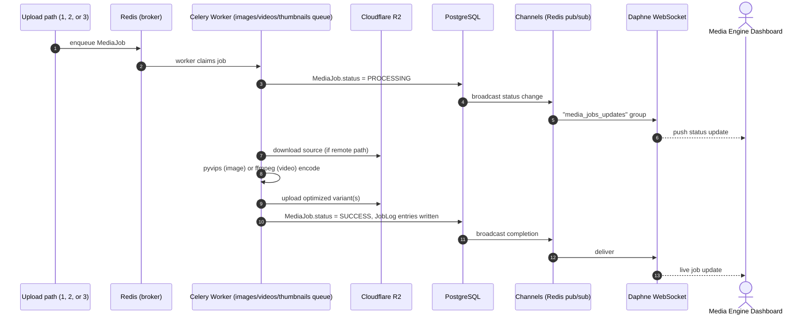
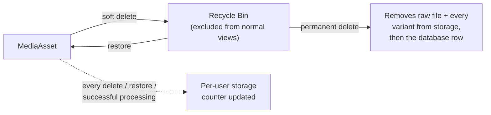

# Media Engine — Processing Pipeline

The Media Engine is Travingat's media optimization pipeline: every photo and video uploaded to the platform is automatically transcoded into a compact, web-optimized format, with live status visible on the Media Engine dashboard (`/media-engine`) and a sandbox testing surface on the Media Portal (`/media-portal`).

---

## 1. Where the code lives

The pipeline is implemented across two focused Django apps in the backend:

| App | Role | Key files |
| :--- | :--- | :--- |
| `media_engine/` | The production optimization pipeline | `models.py`, `tasks.py`, `views.py`, `serializers.py`, `consumers.py`, `urls.py`, `admin.py`, `services/image_processor.py`, `services/video_processor.py`, `services/storage.py` |
| `devportal/` | The sandbox upload path used by the Media Portal | `models.py` (`DevportalImageUpload`, `ServiceSubscription`, `UserStorage`), `views.py`, `tasks.py`, `storage.py` |

Celery task routing and the scheduled-job registry live in `core/celery.py` / `core/settings.py`.

---

## 2. Three ingestion paths, one optimization pipeline

Media reaches the pipeline through three different entry points, chosen based on where the source file lives and who's uploading it — all three converge on the same encode/store/broadcast flow.

```mermaid
flowchart TD
    subgraph Path1["1. Direct upload (admin/internal tools)"]
        A1["Client POSTs file\ndirectly to Django API"] --> A2["MediaViewSet.create()"]
        A2 --> A3["StorageService.save_file()"]
        A3 --> A4["process_image_task.delay() /\nprocess_video_task.delay()"]
    end

    subgraph Path2["2. Remote optimization (creator media)"]
        B1["Creator media in R2\n(profile/avatar/gallery image)"] --> B2["MediaViewSet.remote() action\nor scheduled scan task"]
        B2 --> B3["Create MediaAsset row"]
        B3 --> B4["process_remote_media_task.delay()"]
        B4 --> B5["Download from R2 → process\n→ re-upload as .avif/.webm\n→ remove unoptimized original"]
    end

    subgraph Path3["3. Devportal sandbox (Media Portal UI)"]
        C1["POST /api/internal/devportal/media/presign"] --> C2["Presigned PUT URL\n(travingat-assets bucket)"]
        C2 --> C3["Browser uploads directly to R2"]
        C3 --> C4["POST .../media/process"]
        C4 --> C5["DevportalImageUpload record"]
    end
```



- **Path 1 — Direct upload**: internal/admin tooling posts a file straight to the Django API, which queues image or video processing immediately.
- **Path 2 — Remote optimization**: the primary path for creator-facing media (avatars, gallery photos, collections). Media already living in the production R2 bucket is picked up by an on-demand action or a scheduled scan, processed, and the optimized result is written back in place — no extra upload step required from the client.
- **Path 3 — Devportal sandbox**: a presign → direct-to-R2 → confirm flow used by the internal Media Portal for testing the pipeline in isolation, backed by its own lightweight tracking model.

---

## 3. Data model (`media_engine/models.py`)

```mermaid
erDiagram
    MediaAsset ||--o{ MediaVariant : produces
    MediaAsset ||--o{ MediaJob : processes
    MediaJob ||--o{ JobLog : records

    MediaAsset {
        uuid id
        fk user
        string original_filename
        string original_content_type
        string media_type "IMAGE / VIDEO"
        string status "UPLOADING / PROCESSING / DONE / ERROR"
        string upload_batch_id
        int original_size
        int original_width
        int original_height
        float original_duration
        string blurhash
        string raw_storage_path
        string remote_key "indexed"
        datetime deleted_at "soft delete"
        string delete_reason
    }
    MediaVariant {
        uuid id
        fk media
        string variant_type "OPTIMIZED / THUMBNAIL_720"
        string storage_path
        string content_type
        int width
        int height
        float duration
        int file_size
        int quality
    }
    MediaJob {
        uuid id
        fk media
        string job_type "IMAGE_PROCESSING / VIDEO_PROCESSING / THUMBNAIL_PROCESSING / RAW_CLEANUP"
        string status "PENDING / PROCESSING / SUCCESS / FAILURE / RETRYING"
        int attempts
        string error_message
    }
    JobLog {
        fk job
        string stage
        string message
        datetime timestamp
    }
```

- `MediaAsset` supports soft deletion: a default manager excludes removed rows, and a secondary manager provides access for recovery.
- Each asset produces one optimized variant and one `THUMBNAIL_720` preview.
- Every `MediaJob`/`JobLog` save broadcasts a live update over WebSockets (see §6).

---

## 4. Encoding pipeline

### 4.1 Images — AVIF output via libvips

- Encoder: pyvips, AV1 compression, producing AVIF output.
- **Quality ladder**: tries decreasing quality levels, stopping at the first output under the configured size budget (default 2 MB).
- **Profile media override**: avatars, covers, and profile images are encoded at a fixed high quality rather than the size-driven ladder, prioritizing visual fidelity for the images users see most.
- **Small-file skip**: images already under the minimum optimization threshold (default 250 KB) skip the resize step but are still AVIF-encoded for format consistency.
- **Resize cap**: 1920×1080, never upscaled.
- **Thumbnails**: one size, `THUMBNAIL_720`, AVIF.
- **Blurhash**: a compact blurred placeholder is generated and stored alongside every asset for instant perceived-load rendering.

### 4.2 Video — AV1 + Opus via ffmpeg, output WebM

- Encoding is handled by ffmpeg, using the libsvtav1 codec for video and libopus for audio, producing a WebM container.
- **Quality → compression mapping**: tuned per quality tier, with a matched encode preset.
- **Resize cap**: 1920×1080, same as images.
- **Small-file skip**: videos under the minimum optimization threshold (default 2 MB) are stored unmodified.
- **Size-safety fallback**: if a re-encode would come out larger than the original, the original file is kept as-is — optimization never makes a file bigger.

### 4.3 Size limits

| Setting | Default |
| :--- | :--- |
| Max image upload size | 25 MB |
| Max video upload size | 500 MB |
| Max optimized image output | 2 MB |
| Max optimized video output | 50 MB |
| Image optimization threshold | 250 KB |
| Video optimization threshold | 2 MB |
| Raw file retention | 24 hours |

---

## 5. Celery queues, routing & retries

| Queue | Handles |
| :--- | :--- |
| `images` | Image processing, remote processing, reprocessing |
| `videos` | Video processing |
| `thumbnails` | Thumbnail generation |
| `maintenance` | Raw cleanup, restore/undo, orphan and unoptimized-media scans, database backups, devportal reconciliation/cleanup |

**Retries**: up to 3 attempts with exponential backoff. Two cases skip retry entirely and resolve immediately:

- A corrupt or unreadable source file is soft-deleted into the recycle bin rather than retried.
- A source object missing from R2 (already deleted) is marked accordingly rather than retried.



---

## 6. Job lifecycle & reliability

- **Asset status**: `UPLOADING → PROCESSING → DONE | ERROR`.
- **Job status**: `PENDING → PROCESSING → SUCCESS | FAILURE | RETRYING`, with attempt counts and a structured log per job.
- **Idempotency**: a job checks for an already-produced variant before doing any work, so re-triggering a job never double-processes or double-bills compute/storage.
- **Stale-job reconciliation**: jobs stuck in `PROCESSING` beyond a timeout window are automatically reconciled — marked successful if their output already exists in storage, or marked failed with a clear reason otherwise. This runs as a routine safety net, keeping the dashboard's job list accurate even after an unexpected worker restart.

---

## 7. Real-time status via WebSockets

- A dedicated WebSocket consumer broadcasts to a `media_jobs_updates` group.
- Connections are authorized either from trusted internal network ranges or via a signed admin session, so only authenticated dashboard sessions receive job updates.
- Every job or log update is pushed live, giving the dashboard real-time progress without polling.

---

## 8. Scheduled maintenance jobs

| Task | Schedule | Purpose |
| :--- | :--- | :--- |
| Raw media cleanup | hourly | Removes temporary unprocessed files past the retention window |
| Database backup | hourly | Streams a compressed PostgreSQL snapshot to Cloudflare R2 |
| Storage reconciliation | daily | Keeps per-user storage counters in sync with actual R2 state |
| Devportal sandbox cleanup | every 5 minutes | Housekeeping sweep for the sandbox upload path |

Devportal sandbox uploads are retained permanently by design, supporting ongoing internal testing without unexpected data loss.

---

## 9. Soft delete, recovery & storage accounting



- **Soft delete** moves an asset to a recycle bin state, excluded from all normal views, fully recoverable.
- **Restore** brings a soft-deleted asset back instantly.
- **Permanent delete** removes the raw file and every optimized variant from storage before removing the database record — complete cleanup, not just a row delete.
- **Per-user storage accounting** keeps a running byte counter per user in sync on every delete, restore, and successful processing event, reconciled nightly against actual storage state.

### Unoptimized-media scanning

A scheduled scan walks creator profile, gallery, and collection media, finds anything not yet in optimized format, and queues it for processing automatically — keeping the whole media library consistently optimized without manual intervention. A matching scan covers missing thumbnails.

---

## 10. Storage backend

Media storage is backed by an S3-compatible client pointed at Cloudflare R2, used consistently for raw, optimized, and thumbnail storage across all three ingestion paths.

---

## 11. Access control on pipeline endpoints

Administrative and internal pipeline endpoints are protected by admin-only permissions, combining session-based authentication with environment-configured service tokens for server-to-server calls — keeping the processing pipeline's internal endpoints accessible only to authorized tooling.

---

## 12. Core package versions

| Package | Version |
| :--- | :--- |
| Django | 4.2.30 |
| djangorestframework | 3.16.1 |
| Celery | ≥5.3.4 |
| pyvips | ≥2.2.3 |
| Pillow | ≥10.1.0 |
| blurhash-python | 1.2.2 |
| channels | 4.3.2 |
| channels_redis | 4.3.0 |
| daphne | 4.2.3 |
| boto3 | 1.34.0 |
| django-storages | ≥1.14.2 |
| psycopg2-binary | 2.9.9 |
| djangorestframework-simplejwt | 5.3.1 |
| sentry-sdk | ≥2.73.0 |
| django-prometheus | ≥2.5.0 |
