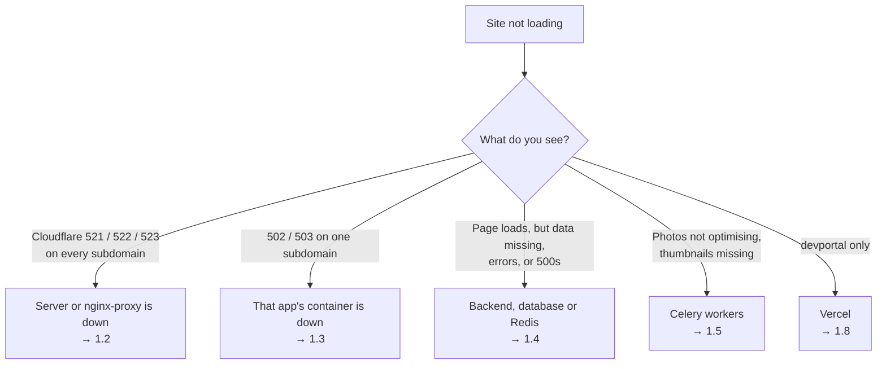
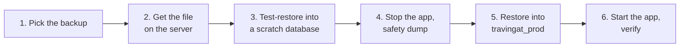
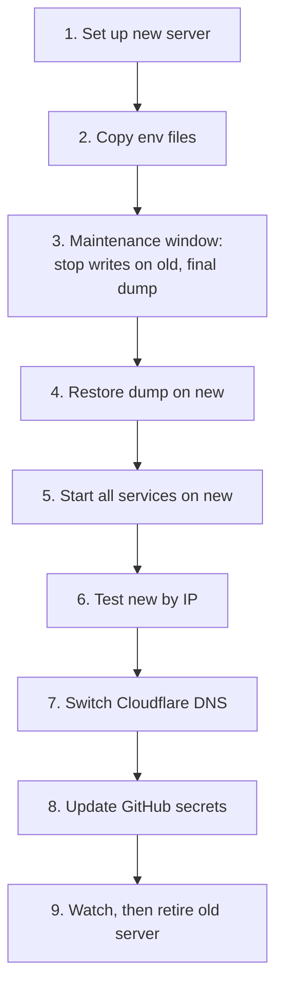

# Runbook — Troubleshooting, Restore & Server Migration

Use this page when production is down, when you need to restore the database, or when you're moving services to a new server. How the system fits together is covered in [Architecture](/tech-docs/Techstack).

> **Rule for every procedure here:** take a fresh database dump *before* you change anything:
>
> ```bash
> docker exec travingat-db pg_dump -U travingat_user -Fc travingat_prod > ~/backups/before-<what>-$(date +%F_%H%M).dump && ls -lh ~/backups/ | tail -3
> ```
>
> The `>` matters: it writes the dump to a file on the server. A dump of a few MB is normal; 0 bytes means it failed.

---

## 0. Quick reference

| Thing | Where |
| :--- | :--- |
| Server | Contabo VPS. The IP is in the Cloudflare DNS A records and the GitHub org secret `SSH_HOST` |
| SSH | `ssh -i <deploy key> root@<server-ip>` |
| Code on the server | `/root/travingat/backend`, `/root/travingat/travingat-landing`, `/root/travingat/travingat-admin` (the workflow defaults; overridden by the `BACKEND_PATH` / `LANDING_PATH` / `ADMIN_PATH` secrets if those are set) |
| Env files | `.env.prod` in each repo folder, with master copies `~/.env.backend`, `~/.env.landing`, `~/.env.admin` (the deploy restores `.env.prod` from these) |
| Containers | `travingat-backend`, `travingat-db`, `travingat-redis`, `travingat-celery-image`, `travingat-celery-thumbnail`, `travingat-celery-maintenance`, `travingat-celery-beat`, `nginx-proxy`, `travingat-landing`, `travingat-admin` |
| Docker network | `travingat-net` (external; created by the deploy scripts) |
| Database volume | `postgres_data` (Docker named volume, usually `backend_postgres_data`) |
| Backups in R2 | bucket `travingat-db-backups`: `backups/hourly/db_backup_travingat_prod_<YYYYMMDD_HHMMSS>.dump` (24 h) and `backups/daily/travingat_prod_<YYYYMMDD>.dump` (30 days) |
| Manual dumps | `~/backups/` on the server |
| Health checks | `https://api.travingat.com/api/health`, `https://app.travingat.com/api/health`, `https://admin.travingat.com/api/health` |
| Redeploy without a code change | GitHub → repo → **Actions → Deploy … → Run workflow** |
| devportal | Vercel (not on the server) |

---

## 1. Something is down

### 1.1 Start here: what is the browser showing?



| Error | Usually means |
| :--- | :--- |
| Cloudflare **521** | The server answered but nothing is listening on port 80, so `nginx-proxy` is down |
| Cloudflare **522 / 523** | Cloudflare can't reach the server at all: it's off, the network is down, or the firewall blocks it |
| **502 / 503** from nginx | `nginx-proxy` is up, but the container for that hostname isn't running or isn't healthy |
| **500** | The app is running but hit an error; check its logs |

### 1.2 Whole site down (521 / 522)

1. **Can you SSH in?**
   - **No:** open the Contabo control panel and check the VPS is running. If it's stuck, use the VNC console or **Restart**. After a reboot, Docker starts on boot and every container has `restart: unless-stopped` (`nginx-proxy`: `always`), so everything should come back on its own. Wait 2–3 minutes, then go to step 2.
   - **Yes:** continue.
2. **Check what's running:**
   ```bash
   docker ps -a --format 'table {{.Names}}\t{{.Status}}'
   ```
   If `nginx-proxy` isn't `Up`:
   ```bash
   docker start nginx-proxy && docker logs --tail 50 nginx-proxy
   ```
3. **Check disk and memory.** A full disk is the most common cause of everything stopping at once.
   ```bash
   df -h /
   free -m
   docker stats --no-stream
   ```
   If the disk is above 90%, free space (this never touches volumes or the database):
   ```bash
   docker system prune -af --volumes=false
   docker builder prune -af
   ls -lh ~/backups/          # delete old manual dumps you no longer need
   ```
4. **Bring the backend stack back:**
   ```bash
   cd /root/travingat/backend && docker compose -f docker-compose.prod.yml up -d
   ```
5. **Firewall** (522 with the server up): `ufw status` must allow 22, 80 and 443.

### 1.3 One app down (502 / 503 on one subdomain)

```bash
docker ps -a --filter name=travingat-landing      # or travingat-admin, travingat-backend
docker logs --tail 100 travingat-landing
docker restart travingat-landing
```

If it keeps exiting, redeploy it: **Actions → Deploy → Run workflow** in that repo. Or on the server:

```bash
cd /root/travingat/travingat-landing
docker compose -f docker-compose.prod.yml up -d --build
```

### 1.4 Backend errors, or the API is down

```bash
docker logs --tail 200 travingat-backend
docker inspect --format '{{.State.Health.Status}}' travingat-backend travingat-db travingat-redis
```

| Log shows | Fix |
| :--- | :--- |
| A migration error near `Applying …` | The new code's migration failed. Read the error. Roll back (§1.7) or fix forward; don't edit the database by hand |
| `could not connect to server` / `travingat-db` unhealthy | `docker logs --tail 100 travingat-db`. Check the disk (§1.2 step 3), then `docker compose -f docker-compose.prod.yml up -d db` |
| `DB_PASSWORD must be set` / other missing env vars | `.env.prod` is missing or incomplete: `cp ~/.env.backend /root/travingat/backend/.env.prod`, then redeploy |
| `Error … connecting to redis` | `docker start travingat-redis`, then restart the backend |
| Repeated `500` on one endpoint | The traceback is in the logs and in Sentry |

Restart the API only:

```bash
docker restart travingat-backend
```

### 1.5 Photos not being optimised

1. **Look at the queue:** open the devportal **Media Engine** dashboard and check for stuck or failed jobs.
2. **Check the workers:**
   ```bash
   docker ps --filter name=travingat-celery --format 'table {{.Names}}\t{{.Status}}'
   docker logs --tail 100 travingat-celery-image
   docker restart travingat-celery-image travingat-celery-thumbnail
   ```
3. **Stuck jobs:** jobs stuck in `PROCESSING` for over 30 minutes can be reconciled from the dashboard.
4. **Check Redis:**
   ```bash
   docker exec travingat-redis redis-cli ping    # expect PONG
   ```

### 1.6 Backups not happening

Check that beat and the maintenance worker are running, then look for the hourly job:

```bash
docker logs --since 2h travingat-celery-maintenance 2>&1 | grep -i backup
```

Run a backup by hand (it uploads to R2 and prints the file path):

```bash
docker exec travingat-celery-maintenance python scripts/backup_to_r2.py
```

`Missing Cloudflare R2 credentials` means the `R2_*` variables are missing from `.env.prod`.

### 1.7 A deploy broke something: roll back

Preferred: on your machine, revert the bad commit and push. The normal deploy then runs.

```bash
git revert <bad-sha> && git push origin main
```

Emergency, on the server (the next push to `main` will overwrite this):

```bash
cd /root/travingat/backend
git log --oneline -5
git reset --hard <last-good-sha>
bash scripts/deploy_production.sh
```

If the bad release ran a **migration**, rolling the code back does not undo it. Either migrate back to the previous migration (`docker exec travingat-backend python manage.py migrate <app> <previous_migration>`), if that migration can be reversed, or restore the database (§2).

**A deploy that never started** (the GitHub Action failed): the backend runs `ruff check .` and `manage.py check` first, and landing and admin typecheck and build. Read the failed job's log. If it failed at SSH, check the `SSH_HOST` / `SSH_KEY` secrets.

### 1.8 devportal down

devportal is on Vercel. Check its deployment in the Vercel dashboard. If its pages load but show no data, the backend is down (§1.4), or the Vercel env vars `BACKEND_URL` / `DEVPORTAL_API_TOKEN` are wrong.

### 1.9 Profile edits don't appear on the site

Saving in admin calls the landing app's revalidation endpoint. Check:

```bash
docker logs --since 10m travingat-backend 2>&1 | grep -i revalidation
```

| Result | Meaning |
| :--- | :--- |
| `status 200` | Working |
| `403` | Cloudflare blocked the request |
| `401` | `REVALIDATION_SECRET` differs between the backend and landing env files |

Pages also refresh on their own within an hour.

---

## 2. Restore the database from a backup



**Restoring replaces the live data** with the backup's. Anything written after the backup was taken is lost, so only do this when it's worth it.

### Step 1: Pick the backup

- **A manual dump** in `~/backups/` (for example the one taken before a risky deploy).
- **An R2 backup:** list the most recent ones:
  ```bash
  docker exec -i travingat-backend python - <<'EOF'
  import os, boto3
  s3 = boto3.client("s3", region_name="auto",
      endpoint_url=f"https://{os.environ['R2_ACCOUNT_ID']}.r2.cloudflarestorage.com",
      aws_access_key_id=os.environ["R2_ACCESS_KEY_ID"],
      aws_secret_access_key=os.environ["R2_SECRET_ACCESS_KEY"])
  bucket = os.getenv("R2_BACKUP_BUCKET", "travingat-db-backups")
  for prefix in ("backups/hourly/", "backups/daily/"):
      objs = s3.list_objects_v2(Bucket=bucket, Prefix=prefix).get("Contents", [])
      for o in sorted(objs, key=lambda o: o["LastModified"])[-8:]:
          print(o["LastModified"], round(o["Size"] / 1e6, 1), "MB", o["Key"])
  EOF
  ```

### Step 2: Get the file onto the server

For an R2 backup, set `KEY` to the key you picked:

```bash
KEY="backups/hourly/db_backup_travingat_prod_20261109_080000.dump"
docker exec -i -e KEY="$KEY" travingat-backend python - <<'EOF'
import os, boto3
s3 = boto3.client("s3", region_name="auto",
    endpoint_url=f"https://{os.environ['R2_ACCOUNT_ID']}.r2.cloudflarestorage.com",
    aws_access_key_id=os.environ["R2_ACCESS_KEY_ID"],
    aws_secret_access_key=os.environ["R2_SECRET_ACCESS_KEY"])
s3.download_file(os.getenv("R2_BACKUP_BUCKET", "travingat-db-backups"), os.environ["KEY"], "/tmp/restore.dump")
print("downloaded", os.path.getsize("/tmp/restore.dump"), "bytes")
EOF
docker cp travingat-backend:/tmp/restore.dump ~/backups/restore.dump
```

Check that the file is a valid dump (this should list tables, with no error):

```bash
docker exec -i travingat-db pg_restore --list < ~/backups/restore.dump | head
```

### Step 3: Test-restore into a scratch database (recommended)

This proves the backup is good without touching production:

```bash
docker exec travingat-db createdb -U travingat_user restore_check
docker exec -i travingat-db pg_restore -U travingat_user -d restore_check --no-owner < ~/backups/restore.dump
docker exec travingat-db psql -U travingat_user -d restore_check -c "select count(*) from users_user; select count(*) from profiles_featuredprofile;"
```

If you only needed to recover a few rows, copy them from `restore_check` and stop here. Drop the scratch database when you're done:

```bash
docker exec travingat-db dropdb -U travingat_user restore_check
```

### Step 4: Stop everything that writes, and take a safety dump

```bash
docker stop travingat-backend travingat-celery-image travingat-celery-thumbnail travingat-celery-maintenance travingat-celery-beat
docker exec travingat-db pg_dump -U travingat_user -Fc travingat_prod > ~/backups/before-restore-$(date +%F_%H%M).dump
```

The site shows 502s from this point until step 6.

### Step 5: Restore into production

```bash
docker exec -i travingat-db pg_restore -U travingat_user -d travingat_prod --clean --if-exists --no-owner < ~/backups/restore.dump
```

`--clean --if-exists` drops each object before recreating it. Warnings about objects that don't exist are normal; errors that stop the restore are not.

### Step 6: Start the app and verify

```bash
cd /root/travingat/backend && docker compose -f docker-compose.prod.yml up -d
docker logs --tail 50 travingat-backend          # migrations: "No migrations to apply" or applying newer ones
curl -s https://api.travingat.com/api/health
```

Then check the photos: compare against a census you recorded earlier, if you have one.

```bash
docker cp ~/backups/census_baseline.json travingat-backend:/tmp/
docker exec travingat-backend python manage.py profile_image_census --compare /tmp/census_baseline.json
```

Finally, open a few profiles and an Explorer Card on the site.

> **Older backups and code:** if the backup predates a migration, starting the current code re-runs the newer migrations on it, which is normal. If the backup is *newer* than the code (after a rollback), deploy the matching code first.

---

## 3. Move to another server

### 3.1 Whole stack to a new server



**1. Set up the new server** (Ubuntu):

```bash
apt update && apt upgrade -y && apt install -y curl git ufw
curl -fsSL https://get.docker.com | sh && systemctl enable --now docker
ufw allow 22/tcp && ufw allow 80/tcp && ufw allow 443/tcp && ufw enable
mkdir -p /root/travingat /root/backups && cd /root/travingat
git clone https://github.com/ss-travingat/travingat-backend.git backend
git clone https://github.com/ss-travingat/travingat-landing.git travingat-landing
git clone https://github.com/ss-travingat/travingat-admin.git travingat-admin
docker network create travingat-net
```

Add the GitHub Actions deploy public key to `/root/.ssh/authorized_keys`, or generate a new pair and update the `SSH_KEY` secret in step 8.

**2. Copy the env files** from the old server. Run this from the new server, or go through your own machine:

```bash
scp root@<old-ip>:'/root/.env.backend /root/.env.landing /root/.env.admin' /root/
cp /root/.env.backend  /root/travingat/backend/.env.prod
cp /root/.env.landing  /root/travingat/travingat-landing/.env.prod
cp /root/.env.admin    /root/travingat/travingat-admin/.env.prod
```

These files hold every secret: database password, R2 keys, email, `REVALIDATION_SECRET`, admin passwords. Never commit them.

**3. Maintenance window: final dump on the old server.**

```bash
# on the OLD server
docker stop travingat-backend travingat-celery-image travingat-celery-thumbnail travingat-celery-maintenance travingat-celery-beat
docker exec travingat-db pg_dump -U travingat_user -Fc travingat_prod > ~/backups/final-move.dump && ls -lh ~/backups/final-move.dump
```

Then copy it to the new server:

```bash
scp root@<old-ip>:~/backups/final-move.dump /root/backups/
```

From here until the DNS switch, the site is down. Keep the window short: test the steps on a recent dump beforehand.

**4. Restore on the new server.** Start only the database first:

```bash
cd /root/travingat/backend && cp .env.prod .env
docker compose --env-file .env.prod -f docker-compose.prod.yml up -d db redis
until docker exec travingat-db pg_isready -U travingat_user -d travingat_prod; do sleep 2; done
docker exec -i travingat-db pg_restore -U travingat_user -d travingat_prod --no-owner < /root/backups/final-move.dump
```

**5. Start everything on the new server:**

```bash
cd /root/travingat/backend            && bash scripts/deploy_production.sh
cd /root/travingat/travingat-landing  && docker compose -f docker-compose.prod.yml up -d --build
cd /root/travingat/travingat-admin    && docker compose -f docker-compose.prod.yml up -d --build
docker ps --format 'table {{.Names}}\t{{.Status}}'
```

**6. Test the new server before switching DNS.** nginx-proxy routes by hostname, so send the hostname yourself:

```bash
curl -s -H "Host: api.travingat.com"   http://<new-ip>/api/health
curl -s -o /dev/null -w "%{http_code}\n" -H "Host: app.travingat.com"   http://<new-ip>/mayaroams
curl -s -o /dev/null -w "%{http_code}\n" -H "Host: admin.travingat.com" http://<new-ip>/login
docker exec travingat-backend python manage.py profile_image_census --out /tmp/census_new.json
```

The census should show the same profile and image counts as on the old server.

**7. Switch DNS.** In Cloudflare, change the **A** records for `api`, `app` and `admin` to the new IP, and keep them **proxied**. Because Cloudflare proxies them, the change takes effect within a minute or two. SSL needs no change: Cloudflare terminates it, in Flexible mode, and talks to the server over port 80.

**8. Update GitHub.** In the `ss-travingat` org secrets, set `SSH_HOST` to the new IP, and update `SSH_KEY` / `SSH_PORT` if they changed. Then run each repo's Deploy workflow once to confirm CI reaches the new server.

**9. Watch, then retire the old server.**
- Watch `docker logs -f travingat-backend` and the [Media Engine](/tech-docs/Media-Engine) dashboard.
- Check that the next hourly backup appears in R2.
- Keep the old server **stopped but not deleted** for a few days. Don't restart its backend: it would write to its own, now stale, database.

### 3.2 Move a single service

All three server apps share one Docker network and one `nginx-proxy`, so moving one away changes how it is reached.

| Moving | What changes |
| :--- | :--- |
| **Landing or admin only** | Run its repo on the new server with its own `nginx-proxy` and `travingat-net` (run the backend's `nginx-proxy` service, or `nginxproxy/nginx-proxy` alone). In its `.env.prod`, change any `BACKEND_URL` / API URL from `http://travingat-backend:8000` (internal) to `https://api.travingat.com`. Point its Cloudflare A record (`app` or `admin`) at the new IP. In that repo's GitHub settings, add a **repository** secret `SSH_HOST` with the new IP; it overrides the org-wide one for that repo only. |
| **Backend only** | Move the backend stack (backend, db, redis, workers, beat, nginx-proxy) together, using §3.1 steps 1–6 for the backend repo. Point `api` at the new IP. Landing and admin on the old server must then use `https://api.travingat.com` instead of the internal hostname, and the old server keeps its own `nginx-proxy` for them. |
| **Database only** (for example, to a managed Postgres) | Restore the final dump into the new database (§3.1 steps 3–4). In the backend's `.env.prod`, set `DATABASE_URL=postgres://…`, which takes precedence over the `DB_*` variables. Redeploy. The local `db` container can stay stopped. Check that the hourly backup still works, since it connects with `DB_HOST` / `DB_PORT` / `DB_USER`. |
| **devportal** | It's on Vercel. To move it, deploy the repo elsewhere with the same env vars (`BACKEND_URL`, `DEVPORTAL_API_TOKEN`) and point the `devportal` DNS record there. |

To compare two databases after a move (table list, row counts per table, sequences), run the parity script. Each server's database listens only on `127.0.0.1:5432`, so reach the other one through an SSH tunnel first, for example `ssh -N -L 15432:127.0.0.1:5432 root@<old-ip>`. Then:

```bash
docker exec travingat-backend python scripts/verify_db_parity.py \
  --source-url "postgres://travingat_user:<pw>@<old-host>:5432/travingat_prod" \
  --target-url "postgres://travingat_user:<pw>@<new-host>:5432/travingat_prod"
```

---

## 4. After any incident

- Write down what happened, how it was found and what fixed it, and link it here if it's likely to happen again.
- If data was restored, tell the team what time the data was restored to.
- Delete scratch databases and old manual dumps you no longer need. Keep at least the most recent good one.
