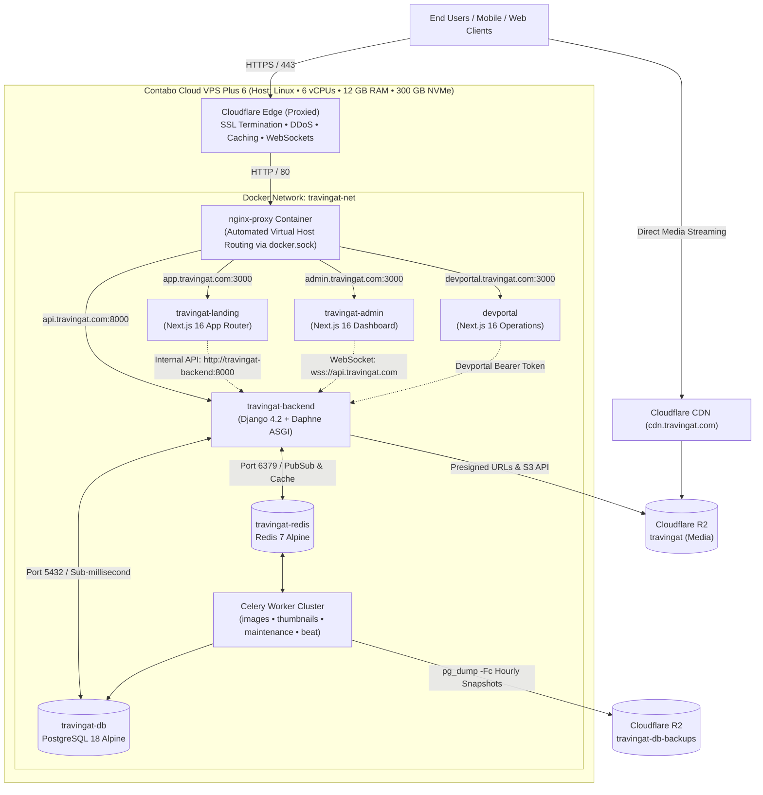
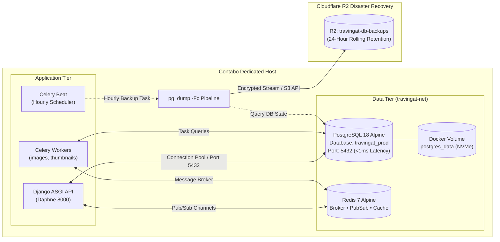
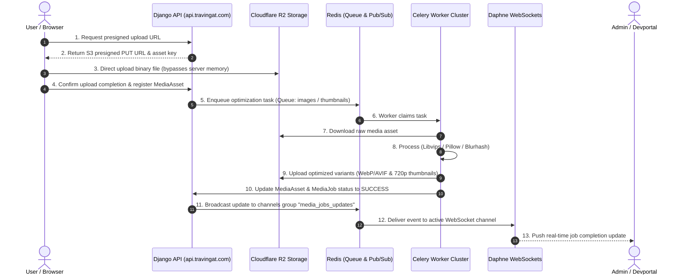
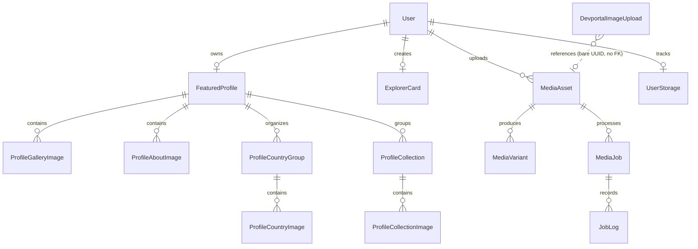

# Travingat — Production Tech Stack & Architecture Overview

Welcome to the production architectural specification of the **Travingat** ecosystem. This document outlines the technology stack, container infrastructure, external cloud services, internal microservices, database topology, and media processing pipelines operating in **Production**.

---

## 1. High-Level Production System Architecture

Travingat operates as a containerized microservice ecosystem hosted on a dedicated Linux VPS behind Cloudflare's edge network. Traffic is routed dynamically through an automated reverse proxy container to independent frontend, administrative, developer, and backend API services.

---

## 2. Production Service Breakdown & Repositories

The Travingat platform is organized into four core production codebases:

| Application | Service Type | Production URL | Framework & Language | Primary Responsibilities |
| :--- | :--- | :--- | :--- | :--- |
| **`travingat-landing`** | Consumer Web App | `https://app.travingat.com` | Next.js 16.4.1, React 19.2.3, TypeScript 5.9.3, Tailwind CSS v4 | Creator discovery, explorer cards, public creator portfolios, location search, and user onboarding. |
| **`travingat-admin`** | Backoffice Dashboard | `https://admin.travingat.com` | Next.js 16.4.3, React 19.2.8, TypeScript 5.9.3, Tailwind CSS v4 | Profile management, creator approvals, social validation, media auditing, and real-time WebSocket job logs. |
| **`devportal`** | Engineering Portal | `https://devportal.travingat.com` | Next.js 16.4.3, React 19.3.0, TypeScript 5.0, Tailwind CSS v4 | Cloud subscriptions & spend tracking, Media Engine ops, and technical documentation with interactive Mermaid charts. |
| **`backend`** | Core ASGI Microservice | `https://api.travingat.com` | Python 3.12, Django 4.2.30 LTS, DRF 3.16.1, Daphne 4.2.3 | REST APIs, Django Channels WebSockets, Celery task scheduling, media optimization, and automated backups. |

---

## 3. Host Infrastructure & Resource Allocation

Production runs on a dedicated **Contabo Cloud VPS Plus 6** instance managed with Docker Compose and connected through an external Docker bridge network (`travingat-net`).

### Host Specifications

- **Operating System:** Ubuntu Linux LTS
- **CPU:** 6 Dedicated vCPUs
- **Memory:** 12 GB RAM
- **Storage:** 300 GB NVMe SSD
- **Reverse Proxy:** `nginxproxy/nginx-proxy:alpine` bound to host port `80:80`

### Production CPU & Memory Budget Allocation

| Container Name | Service / Role | CPU Limit | Memory Limit | Internal Port | Public Endpoint / Routing |
| :--- | :--- | :--- | :--- | :--- | :--- |
| `travingat-landing` | Next.js App Router | 1.0 Core | 1536 MB | `3000` | `https://app.travingat.com` |
| `travingat-admin` | Next.js Admin App | 1.0 Core | 1536 MB | `3000` | `https://admin.travingat.com` |
| `devportal` | Next.js Developer Portal | 0.5 Core | 512 MB | `3000` | `https://devportal.travingat.com` |
| `travingat-backend` | Django Daphne ASGI API | 1.0 Core | 1536 MB | `8000` | `https://api.travingat.com` |
| `travingat-db` | Dedicated PostgreSQL 18 Alpine | 1.0 Core | 2048 MB | `5432` | Internal (`travingat-net:5432`) |
| `travingat-redis` | Redis 7 Alpine Broker & Cache | 0.3 Core | 512 MB | `6379` | Internal (`travingat-net:6379`) |
| `travingat-celery-image` | Worker (`-Q images -c 2`) | 1.0 Core | 1536 MB | — | Internal Worker |
| `celery-thumbnail` | Worker (`-Q thumbnails -c 2`) | 1.0 Core | 1536 MB | — | Internal Worker |
| `celery-maintenance` | Maintenance & Cleanup Worker | 0.2 Core | 512 MB | — | Internal Worker |
| `celery-beat` | Periodic Task Scheduler | 0.1 Core | 256 MB | — | Internal Scheduler |
| `nginx-proxy` | Automated Reverse Proxy | 0.4 Core | 256 MB | `80` (Host) | Ports `80:80` (HTTP) |
| **OS / Headroom** | Host Kernel, NVMe I/O Buffer | ~0.5 Core | ~1.5 GB | — | Host system buffer |

---

## 4. Database Architecture & Disaster Recovery

The production database is hosted directly within the Contabo environment on **PostgreSQL 18 Alpine**, providing sub-millisecond query latency and eliminating serverless connection limits.

### Key Database Properties

- **Engine:** PostgreSQL 18 Alpine (`postgres:18-alpine`).
- **Storage Volume:** Docker named volume `postgres_data` mapped to NVMe SSD.
- **Connection Pooling:** Managed via Django connection persistent pools (`conn_max_age=600`).
- **Metrics Wrapping:** Database queries wrapped with `django_prometheus.db.backends.postgresql` for latency and query counter exports.
- **Automated Backup Strategy:**
  - Scheduled hourly via Celery Beat (`core.celery.backup_db_to_r2_task`).
  - Executes `pg_dump -Fc` custom archive compression with integrity validation.
  - Streams snapshots directly to Cloudflare R2 bucket `travingat-db-backups`.
  - Enforces a rolling 24-hour retention window, automatically purging older backups offsite.

---

## 5. Media Engine & Asynchronous Processing Pipeline

Travingat uses a direct-to-storage upload pattern. Media binaries never pass through frontend or backend web server memory, protecting CPU and network bandwidth.

### Storage Buckets & Policies

1. **`travingat` (Cloudflare R2):**
   - Stores permanent creator media, profile avatars, headers, and Explorer Cards.
   - Served publicly through `https://cdn.travingat.com` with edge cache headers (`minimumCacheTTL: 31536000`).
2. **`travingat-assets` (Cloudflare R2):**
   - Temporary staging bucket for devportal image processing test runs.
   - Automated 15-minute expiration worker (`devportal.cleanup_expired_images`) purges assets from R2 and updates DB logs.
3. **`travingat-db-backups` (Cloudflare R2):**
   - Private bucket for hourly PostgreSQL snapshots with rolling 24-hour cleanup.

---

## 6. Core Data Domain & Entity Relationships

The core relational models in PostgreSQL are structured to support fast denormalized read views for creator profiles while retaining relational integrity:

The full column-level schema for users, profiles and Explorer Cards is in [Data Model](/tech-docs/Data-Model).

### Model Responsibilities

- **`User`:** The single record for a person: name, home country, avatar and cover photo, visited countries (ISO codes), and the featured / badge / sample / card-style flags. Profiles and Explorer Cards read these from here.
- **`FeaturedProfile`:** The creator's profile content: handle, bio, social links, review status, profile-page crops, and country/collection counters.
- **`ProfileCountryGroup` & `ProfileCollection`:** Groups creator photos by visited country and curated albums with custom header stacks and blurhashes.
- **`ExplorerCard`:** The travel passport card: per-style cover crops (*Classic*, *Minimal*, *Adventure*), the profile-photo crop, and any cover/profile photo uploaded on the card itself (otherwise it shows the user's).
- **`MediaAsset` & `MediaVariant`:** Comprehensive media asset tracking tracking original sizes, MIME types, processing statuses, soft deletes, and derivative WebP/AVIF/thumbnail files.
- **`ServiceSubscription`:** Operational expense tracking in Devportal for cloud services, recurring fees, and billing frequencies. Its `owner` is a plain name field, not a link to a user.

---

## 7. Production Technology Matrix

### Frontend Applications (`travingat-landing`, `travingat-admin`, `devportal`)

| Category | Package / Tool | Version | Purpose in Production |
| :--- | :--- | :--- | :--- |
| **Framework** | Next.js | `16.4.x` | High-performance App Router, Server Components (RSC), route handlers, and standalone Docker builds. |
| **UI Library** | React & React DOM | `19.2.x` / `19.3.x` | Concurrent rendering, Server Actions, modern hook APIs. |
| **Language** | TypeScript | `5.9.x` | Strict type definitions across API contracts, form states, and schemas. |
| **Styling** | Tailwind CSS | `v4.x` | Zero-runtime CSS styling, arbitrary pixel-perfect Figma values, and typography plugins. |
| **State & Fetching** | TanStack React Query | `v5.x` | Client-side cache synchronization, optimistic mutations, and window focus refetching. |
| **Headless UI** | Radix UI Primitives | `1.x` | Accessible modal dialogs (`@radix-ui/react-dialog`), popovers, tabs, and tooltips. |
| **Drag & Drop** | `@dnd-kit/core` & `sortable` | `6.x` / `10.x` | Drag-and-drop album reordering and country list arrangement in admin editor. |
| **Canvas Exports** | `modern-screenshot` & `jszip` | `4.7.x` / `3.10.x` | Client-side DOM canvas snapshots of Explorer Cards and multi-card ZIP packaging. |
| **Image Placeholders** | `blurhash` / `react-blurhash` | `2.x` / `0.3.x` | Low-overhead blurred canvas placeholders rendered prior to high-res media download. |
| **Diagrams & Docs** | `mermaid` & `react-markdown` | `12.2.x` / `10.1.x` | Dynamic client-side SVG diagram rendering inside Devportal documentation. |
| **Storage Uploads** | `@aws-sdk/s3-request-presigner` | `3.1156.x` | S3 client generating presigned URLs for direct browser-to-R2 uploads. |
| **Video Player** | `react-player` | `3.4.x` | Responsive video player component for creator portfolio videos and media previews. |
| **Geocoding** | Komoot Photon API | REST | OpenStreetMap-powered geocoding search and autocomplete for cities and countries. |

### Backend Service (`travingat-backend`)

| Category | Package / Tool | Version | Purpose in Production |
| :--- | :--- | :--- | :--- |
| **Web Framework** | Django | `4.2.30 LTS` | Core ORM, security middleware, database migrations, and signals. |
| **REST API** | Django REST Framework | `3.16.1` | Serializers, API views, throttles, and permission checks. |
| **ASGI & WebSockets** | Daphne & Channels | `4.2.3` / `4.3.2` | High-performance ASGI HTTP/WebSocket server handling live job log feeds. |
| **Channels Broker** | `channels_redis` | `4.3.0` | Redis-backed pub/sub channel layer for distributing WebSocket events across processes. |
| **Async Task Queue** | Celery | `5.3.x+` | Distributed worker pool processing image conversions, thumbnails, and maintenance. |
| **Fast Image Engine** | `pyvips` (Libvips) | `2.2.x+` | Memory-efficient, multi-threaded C-level image pipeline for resizing and WebP conversion. |
| **Image Utilities** | `Pillow` & `blurhash-python` | `10.1.x+` / `1.2.x` | Image header inspection, metadata extraction, and compact blurhash generation. |
| **S3 Storage Provider** | `boto3` & `django-storages` | `1.34.x` / `1.14.x` | S3 client interacting with Cloudflare R2 for asset storage and presigned URL creation. |
| **Database Adapter** | `psycopg2-binary` | `2.9.9` | High-speed C-based PostgreSQL connection adapter. |
| **Authentication** | `djangorestframework-simplejwt` | `5.3.1` | Cookie-based and header-based JWT tokens for admin and API authentication. |
| **Metrics & Monitoring** | `django-prometheus` | `2.5.x+` | Exposes Prometheus metrics at `/metrics` (authenticated with `METRICS_TOKEN`). |
| **Error Tracking** | `sentry-sdk` | `2.73.x+` | Automated production exception capture for Django and Celery workers. |
| **Structured Logging** | `python-json-logger` | `4.0.x+` | Correlated JSON log output with request IDs for log aggregation. |

---

## 8. Production Security, Networking & Observability

### Edge & SSL Configuration

- **Cloudflare Flexible / Full SSL:** Cloudflare handles public SSL certificates at edge nodes with *Always Use HTTPS* and *Automatic HTTPS Rewrites* enabled.
- **Port Isolation:** Only host port `80` is open to the external network on the Contabo VPS. The database (5432), Redis (6379), and backend APIs (8000) are private to the internal `travingat-net` bridge network.
- **WebSocket Pass-Through:** Cloudflare WebSockets are active on `api.travingat.com`, allowing bi-directional streaming from Daphne ASGI to admin clients.

### Application Hardening

- **Cookie Security:** Cookies are hardened with `SameSite=Strict`, `Secure=True`, and `HttpOnly=True` in production.
- **CORS Whitelist:** Restricted to explicit production origins:
  - `https://travingat.com`
  - `https://www.travingat.com`
  - `https://app.travingat.com`
  - `https://admin.travingat.com`
  - `https://devportal.travingat.com`
- **Rate Limiting & Throttling:** Configured via Django REST Framework and Redis cache:
  - `admin_login`: 5 requests / minute
  - `explorer_card_create`: 10 requests / hour
  - `explorer_card_detail`: 60 requests / minute
- **Observability:**
  - Standardized JSON logs correlation using `RequestIDMiddleware` (`X-Request-ID`).
  - System healthchecks configured at `/api/health` across all containers.
  - Sentry exception logging integrated into both ASGI request handlers and Celery task execution.
