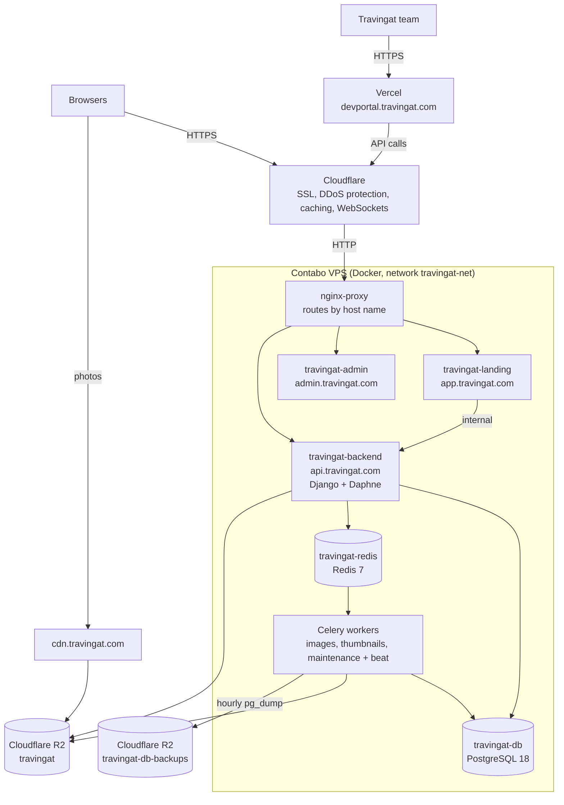
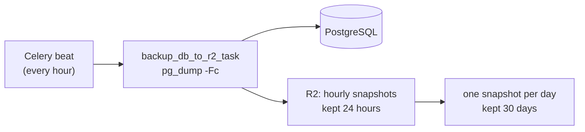
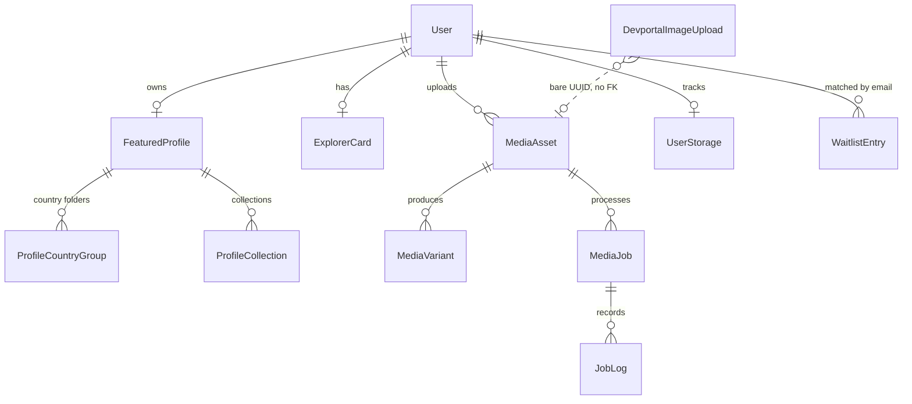

# Architecture — Production Infrastructure

Travingat runs on a single Contabo VPS with Docker, behind Cloudflare. The VPS hosts the Django backend, PostgreSQL, Redis, the Celery workers, and the two customer-facing Next.js apps. The developer portal is the exception: it is hosted on Vercel.

---

## 1. System overview



`travingat.com` itself is the Framer marketing site. A Cloudflare Worker sends Framer's own routes to Framer and redirects any other path (a username) to `app.travingat.com/<username>`.

---

## 2. Services and repositories

| Repository | Serves | Hosted on | Stack | Responsibilities |
| :--- | :--- | :--- | :--- | :--- |
| `travingat-landing` | `app.travingat.com` | Contabo VPS | Next.js 16.4, React 19.2, TypeScript 5.9, Tailwind 4 | Public creator profiles, Explorer Cards, Get Featured application and profile builder |
| `travingat-admin` | `admin.travingat.com` | Contabo VPS | Next.js 16.4, React 19.2, TypeScript 5.9, Tailwind 4 | Profile review, Get Featured approvals, profile editor, waitlist, users, recycle bin |
| `devportal` | `devportal.travingat.com` | Vercel | Next.js 16.4, React 19.3, Tailwind 4, Mermaid 12 | Media Engine dashboards, service-cost tracking, these docs |
| `backend` | `api.travingat.com` | Contabo VPS | Python 3.11, Django 4.2.30, DRF 3.16, Daphne 4.2, Channels 4.3 | All APIs and business rules, WebSockets, Celery jobs, media processing, backups |

**Deploys.** A push to `main` deploys each app:
- **Backend:** GitHub Actions runs `ruff` and `manage.py check`, then SSHes to the VPS, resets to `origin/main` and rebuilds the containers. Migrations run when the container starts.
- **Landing:** GitHub Actions typechecks and builds, then deploys to the VPS.
- **Devportal:** Vercel builds and deploys it from GitHub.

---

## 3. Containers on the VPS

| Container | Role | Resource limit |
| :--- | :--- | :--- |
| `travingat-backend` | Django API served by Daphne (port 8000) | none set |
| `travingat-db` | PostgreSQL 18 Alpine, volume `postgres_data` | 1 CPU, 2048 MB |
| `travingat-redis` | Redis 7: Celery broker, Channels layer, cache | none set |
| `travingat-celery-image` | Worker for the `images` queue, 2 processes | 1 CPU, 1536 MB |
| `travingat-celery-thumbnail` | Worker for the `thumbnails` queue, 2 processes | 1 CPU, 1536 MB |
| `travingat-celery-maintenance` | Worker for the `maintenance` queue | none set |
| `travingat-celery-beat` | Schedules the periodic jobs | none set |
| `nginx-proxy` | Routes `*.travingat.com` to containers by `VIRTUAL_HOST`; the only public port (80) | none set |
| `travingat-landing`, `travingat-admin` | Next.js apps (port 3000) | set in their own deploy configs |

There is no worker for the `videos` queue in production. That is fine while video upload is disabled in the product, but a `videos` worker must be added before video is switched on.

---

## 4. Database and backups

- **Engine:** PostgreSQL 18 (`postgres:18-alpine`), database `travingat_prod`, private to the Docker network.
- **Connections:** persistent connections (`conn_max_age=600`); queries are wrapped by `django_prometheus` for metrics.
- **Schema:** see [Data Model](/tech-docs/Data-Model) for users, profiles and cards, and [Media Engine](/tech-docs/Media-Engine) for media tables.



- **Hourly backup:** `core.celery.backup_db_to_r2_task` runs `pg_dump -Fc` and uploads it to the `travingat-db-backups` R2 bucket. It retries 3 times on failure.
- **Retention:** hourly snapshots are kept for 24 hours, and one snapshot per day is promoted and kept for 30 days.
- **Before risky changes:** take a manual dump on the VPS as well:
  ```bash
  docker exec travingat-db pg_dump -U travingat_user -Fc travingat_prod > ~/backups/<name>.dump
  ```

---

## 5. Storage buckets

| Bucket | Contents | Access |
| :--- | :--- | :--- |
| `travingat` | All production photos: avatars, covers, country and collection photos, card photos, optimised variants | Public through `cdn.travingat.com` |
| `travingat-assets` | Uploads made in the devportal Media Portal sandbox | Kept permanently; the 5-minute cleanup only purges legacy uploads that still have an expiry |
| `travingat-db-backups` | Database snapshots | Private |

Browsers upload straight to R2 with presigned URLs, so files never pass through the web servers. See [Media Engine](/tech-docs/Media-Engine) for what happens next.

---

## 6. Scheduled jobs

| Job | Schedule | Purpose |
| :--- | :--- | :--- |
| `cleanup_raw_media_task` | hourly | Deletes raw uploads older than 24 hours once processed |
| `backup_db_to_r2_task` | hourly | Database backup (above) |
| `scan_unoptimized_media_task` | every 2 hours | Finds profile and card photos not yet optimised and queues them |
| `scan_missing_thumbnails_task` | nightly, 04:00 | Queues 720p thumbnails that are missing |
| `devportal.reconcile_user_storage` | nightly, 03:00 | Checks per-user storage counters against R2 (dry run) |
| `devportal.cleanup_expired_images` | every 5 minutes | Purges legacy sandbox uploads past their expiry |

---

## 7. Security and networking

**Edge**
- Cloudflare terminates SSL for every `*.travingat.com` host and passes WebSockets through on `api.travingat.com`.
- Only port 80 is open on the VPS. PostgreSQL (5432), Redis (6379) and the API (8000) are reachable only inside `travingat-net`.
- Cloudflare blocks requests that use default scripting User-Agents (for example `Python-urllib`). Server-to-server calls must send their own User-Agent. The backend's landing revalidation call does.

**Cookies and sessions**
- Creator login: one-time email code, then JWT `access_token` / `refresh_token` cookies (`HttpOnly`, `SameSite=Lax`).
- Admin and devportal login: a signed `admin_session` cookie issued by the backend (`HttpOnly`, `SameSite=Lax`, 24 hours).
- Django's own session and CSRF cookies: `SameSite=Strict`, `Secure` in production.

**CORS:** the production origins (`travingat.com`, `www`, `app`, `admin`), the dev hosts, localhost, and any `https://*.travingat.com` subdomain.

**Rate limits (per DRF throttle)**

| Throttle | Limit |
| :--- | :--- |
| Admin login | 5 / minute |
| OTP request | 20 / hour per IP, 10 / hour per email |
| OTP verify | 20 / hour per IP and per email |
| Explorer Card create | 10 / hour (5 / hour per email) |
| Explorer Card read | 60 / minute |
| Explorer Card update | 30 / minute |
| Upload presign | 150 / hour per IP |

**Observability**
- JSON logs carry a request ID (`X-Request-ID`) from `RequestIDMiddleware`.
- Prometheus metrics are at `/metrics` (token-protected), and the health check is at `/api/health`.
- Sentry captures exceptions from both web requests and Celery tasks.

---

## 8. Core data relationships



Column-level detail is in [Data Model](/tech-docs/Data-Model) and [Media Engine](/tech-docs/Media-Engine). `ServiceSubscription` (devportal cost tracking) has no link to users; its `owner` is a name.
