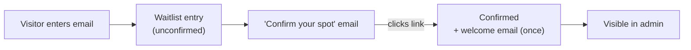

# Waitlist & Early Access

The waitlist is Travingat's early-access signup. It's an email field that works on any page, including the Framer marketing site, and posts to the same backend as the product. Each waitlist entry also tracks the person through Get Featured.

---

## 1. Signing up

1. **Submit:** the visitor enters an email (`POST /api/waitlist`). The entry is created unconfirmed, with a confirmation token.
2. **Confirm:** a "Confirm your spot" email links to `app.travingat.com/waitlist/confirm?token=…`. Clicking it confirms the entry.
3. **Welcome:** a "Welcome to Travingat" email is sent once per person, whichever way they arrive (waitlist confirmation or Get Featured). `welcome_email_sent_at` stops it being sent twice.
4. **Context:** browser, device, country, city and IP are recorded automatically.
5. **Repeat signups:** an email that's already confirmed gets a "you're already on the list" response. An unconfirmed one gets a fresh confirmation email instead of a duplicate entry.

---

## 2. What an entry records

| Field | Meaning |
| :--- | :--- |
| `email` | Unique; the key for the entry |
| `user_id` | Link to the person's user account, once they have one |
| `confirmed`, `confirmed_at` | Whether they clicked the confirmation link |
| `source` | Where the signup came from (e.g. `Waitlist`) |
| `browser`, `device`, `country`, `city`, `ip` | Signup context |
| `get_featured_status` | Where they are in [Get Featured](/tech-docs/Get-Featured) |
| `featured_application` | The exact application they submitted, frozen at submit time |
| `explorer_card_status`, `card_style`, `countries_count` | Explorer Card progress |
| `welcome_email_sent_at` | When the welcome email went out |
| `deleted_at` | Set when removed in admin (recoverable from the recycle bin) |

The entry is matched to the user by email. `user_id` is filled in when an account with that email exists.

---

## 3. In admin

Every entry, confirmed or not, is listed in admin with its signup context, Get Featured status and Explorer Card progress. Staff can:
- resend the confirmation email;
- remove an entry, which sends it to the recycle bin.

---

## 4. Why it's built this way

- **Works anywhere:** the signup is a plain API call, so the Framer site can use it without sharing code with the product.
- **Confirmed interest:** the confirmation step filters out typos and low-intent signups.
- **One record across the funnel:** the same entry follows the person from waitlist to Explorer Card to Get Featured, so admin sees one timeline per person.
