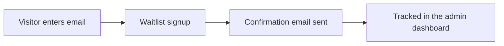

# Waitlist & Early Access

The waitlist is Travingat's early-access signup mechanism — a simple email-capture component embedded across marketing surfaces (including the Framer-hosted marketing site) that feeds directly into the same backend used by the core product.

---

## 1. How It Works

A visitor enters their email into a waitlist widget — available as a standalone embeddable component for use on any marketing page, including the separate Framer-hosted site. On submission:

1. The email is validated and recorded.
2. A confirmation email is sent, with a link the visitor clicks to confirm their spot.
3. Browser and location context (device type, browser, approximate region) is captured automatically, giving the team visibility into where signups are coming from without requiring any extra input from the visitor.
4. Already-confirmed emails are recognized gracefully — a returning visitor sees a friendly "you're already on the list" message rather than a duplicate signup.

---

## 2. Admin Visibility

Every waitlist signup — confirmed or pending — is visible in the `travingat-admin` dashboard, alongside the same browser/device/location context captured at signup. This gives the team a real-time view of growth momentum and lets staff follow up directly from the dashboard.

---

## 3. Why It's Built This Way

- **Embeddable anywhere**: the widget is a drop-in component that works on any page, including the standalone marketing site, without requiring that page to share Travingat's backend or codebase.
- **Confirmed interest, not just emails**: the confirmation-email step filters out typos and low-intent signups, so the number in the dashboard reflects genuinely interested people.
- **Zero-friction for the visitor**: one field, one click — device and location context are inferred automatically rather than asked for.
