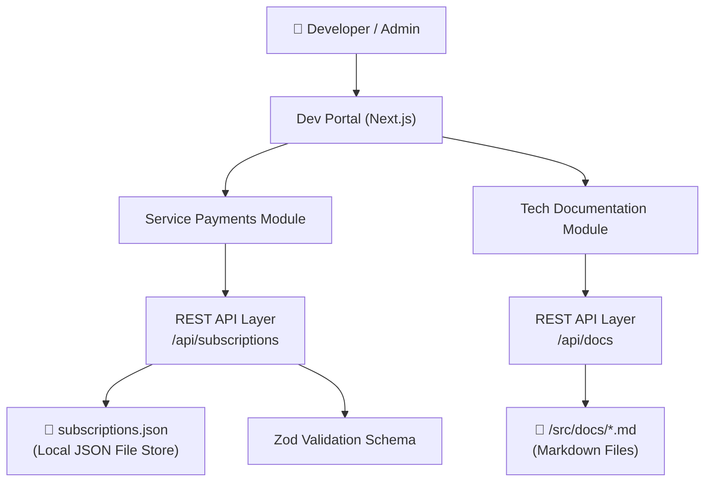
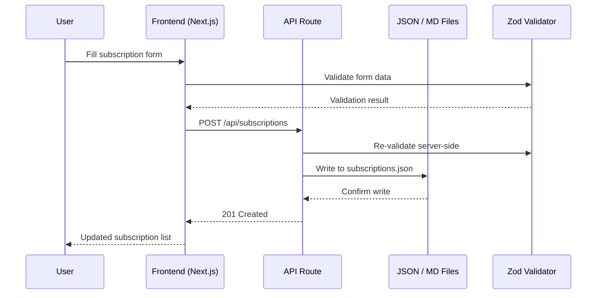
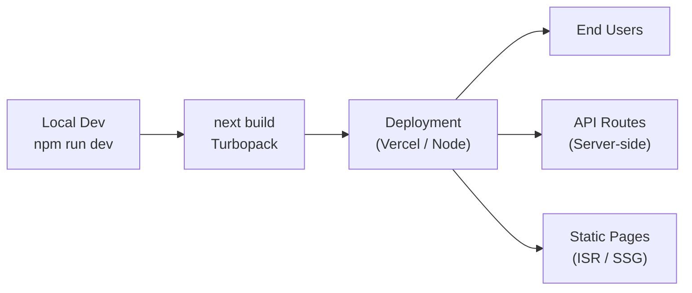

# Architecture Overview

This document describes the high-level architecture of the **Dev Portal** platform, including the relationships between core services, data stores, and external vendors.

## System Components

## Module Breakdown

### 1. Service Payments Module
Manages recurring vendor subscriptions with full CRUD operations.

| Layer | Technology |
|-------|-----------|
| UI | React + Tailwind CSS v4 |
| Validation | Zod v4 |
| Storage | JSON File (`subscriptions.json`) |
| API | Next.js App Router Route Handlers |

### 2. Tech Documentation Module
Stores and renders Markdown documentation with Mermaid diagram support.

| Layer | Technology |
|-------|-----------|
| Renderer | react-markdown + remark-gfm |
| Diagrams | Mermaid.js |
| Storage | `.md` files in `/src/docs/` |
| API | Next.js App Router Route Handlers |

## Data Flow

## Deployment Architecture

