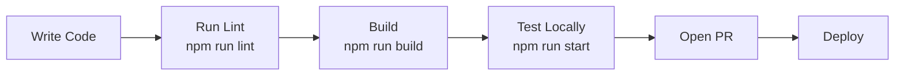

# Getting Started

Welcome to the **Dev Portal**. This guide walks you through setting up the project locally and understanding the project structure.

## Prerequisites

| Tool | Version |
|------|---------|
| Node.js | >= 22.x |
| npm | >= 10.x |
| Git | Latest |

## Installation

```bash
# Clone the repository
git clone https://github.com/your-org/dev-portal.git
cd dev-portal

# Install dependencies
npm install

# Start development server
npm run dev
```

Open [http://localhost:3000](http://localhost:3000) in your browser.

## Project Structure

```
dev-portal/
├── src/
│   ├── app/                  # Next.js App Router pages & API routes
│   │   ├── api/
│   │   │   ├── subscriptions/ # Service Payments REST API
│   │   │   └── docs/          # Documentation REST API
│   │   ├── page.tsx          # Home page (client component)
│   │   └── layout.tsx        # Root layout
│   ├── components/           # Reusable React components
│   │   ├── SubscriptionFormModal.tsx
│   │   ├── SubscriptionTable.tsx
│   │   ├── SubscriptionDetailModal.tsx
│   │   ├── SubscriptionMetrics.tsx
│   │   └── MarkdownViewer.tsx
│   ├── docs/                 # Markdown documentation files
│   │   ├── getting-started.md
│   │   ├── architecture-overview.md
│   │   └── api-reference.md
│   ├── lib/                  # Utilities & validation
│   │   ├── storage.ts
│   │   └── validations/
│   │       └── subscription.ts
│   ├── types/                # TypeScript type definitions
│   │   └── subscription.ts
│   └── data/                 # JSON data files
│       └── subscriptions.json
├── public/
├── next.config.ts
├── tailwind.config.ts
└── package.json
```

## Available Scripts

| Command | Description |
|---------|-------------|
| `npm run dev` | Start development server on port 3000 |
| `npm run build` | Build production bundle |
| `npm run start` | Start production server |
| `npm run lint` | Run ESLint checks |

## Development Workflow



## Adding a New Document

1. Create a `.md` file in `src/docs/`
2. Add frontmatter at the top:

```markdown
---
title: My Document Title
description: Short description of the document
category: Guides
author: Your Name
updatedAt: 2026-10-30
---

# Content here...
```

3. The document will automatically appear in the Tech Documentation module.

